# CORTEX-M Complete Ecosystem Architecture & Operational Flow Diagrams

This document provides complete, high-resolution architecture diagrams and operational sequence flows across the **CORTEX-M Neural Core**, the **Master Subsystems (`ResearchEngine`, `LabHarness`)**, the **Unified Ecosystem Gateway**, and all **8 Specialized Industrial Platforms**.

---

## 1. Global High-Level Ecosystem Topology

The diagram below illustrates how client interfaces (Web Studio, CLI, and External REST APIs) route through the **Unified Ecosystem Gateway**, interact with the deterministic safety interlocks and neural Hopfield substrate, and fan out to the 8 domain-specific platforms.

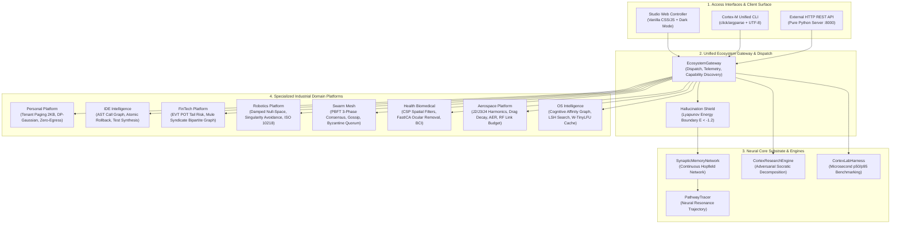

---

## 2. Core Neural Learning & Recurrent Recall Flow

The diagram below details the **Hebbian Synaptic Learning**, **Continuous Hopfield Recurrent Retrieval**, and **Lyapunov Energy Certification** cycle.

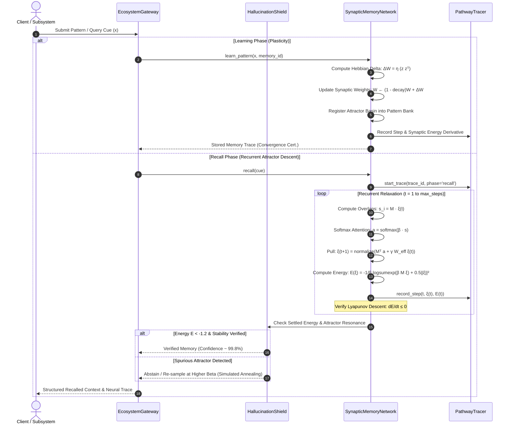

---

## 3. Platform Operational Architectures

### 3.1 Aerospace Platform (`platforms/space`)
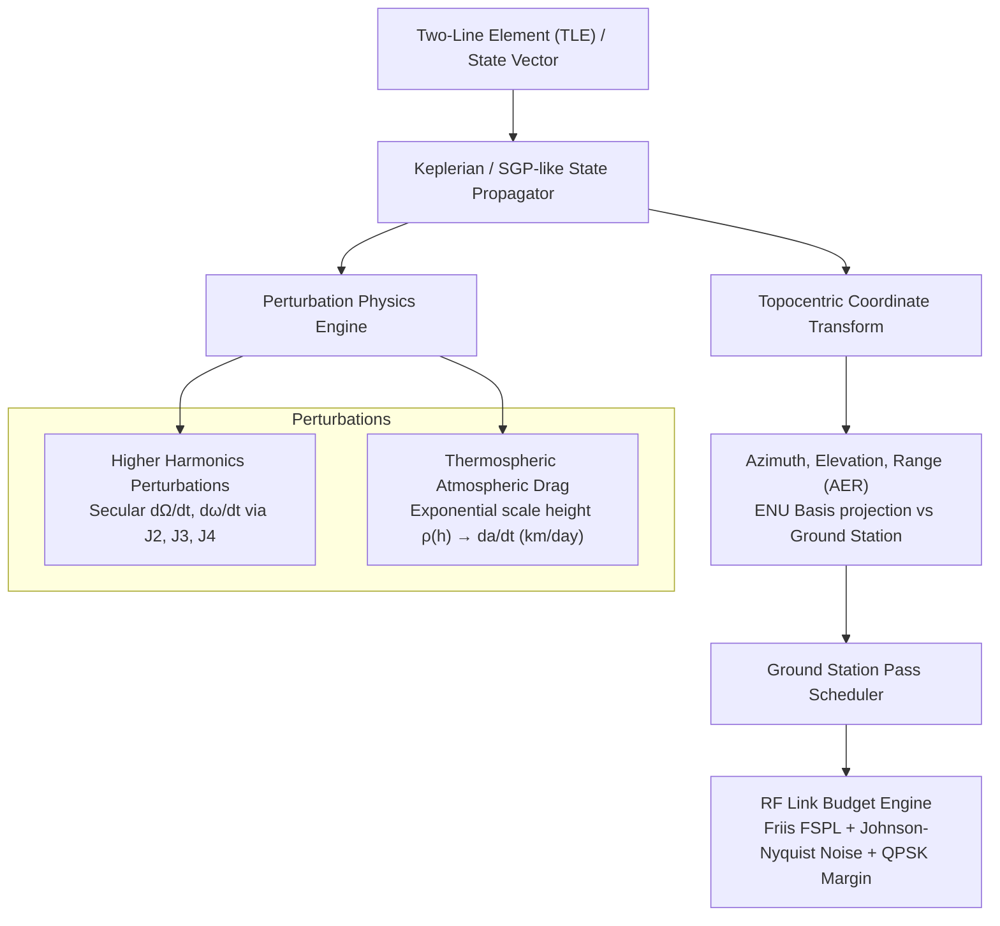

---

### 3.2 Robotics Platform (`platforms/robotics`)
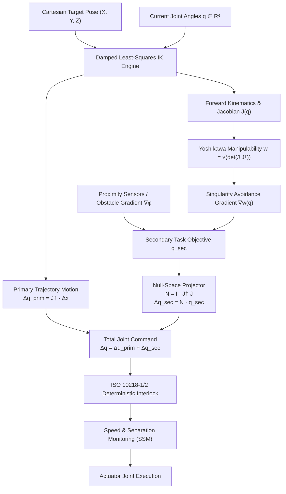

---

### 3.3 Operating System Platform (`platforms/os`)
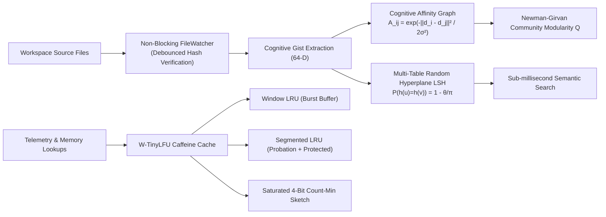

---

### 3.4 Personal Security Platform (`platforms/personal`)
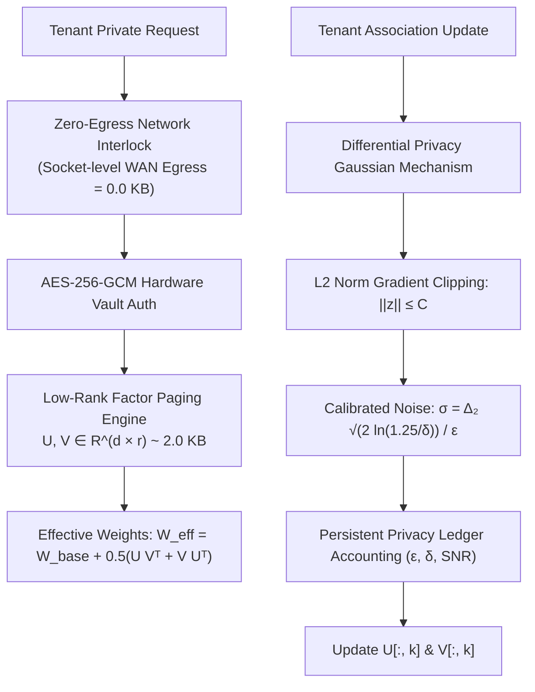

---

### 3.5 IDE Platform (`platforms/ide`)
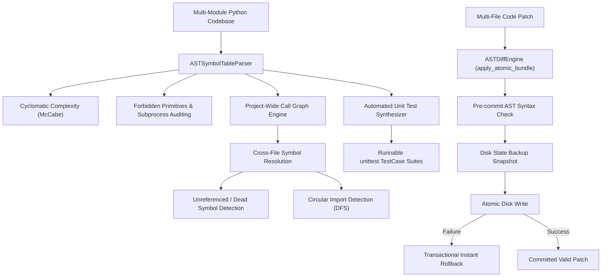

---

### 3.6 FinTech Risk Platform (`platforms/fin`)
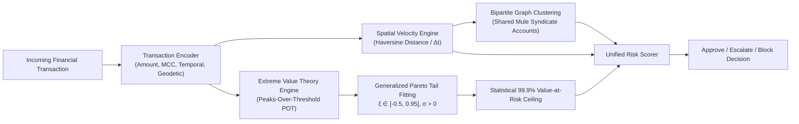

---

### 3.7 Biomedical Health Platform (`platforms/health`)
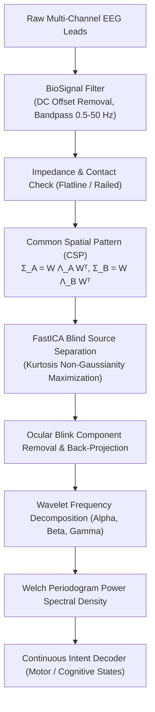

---

### 3.8 Swarm Mesh Platform (`platforms/mesh`)
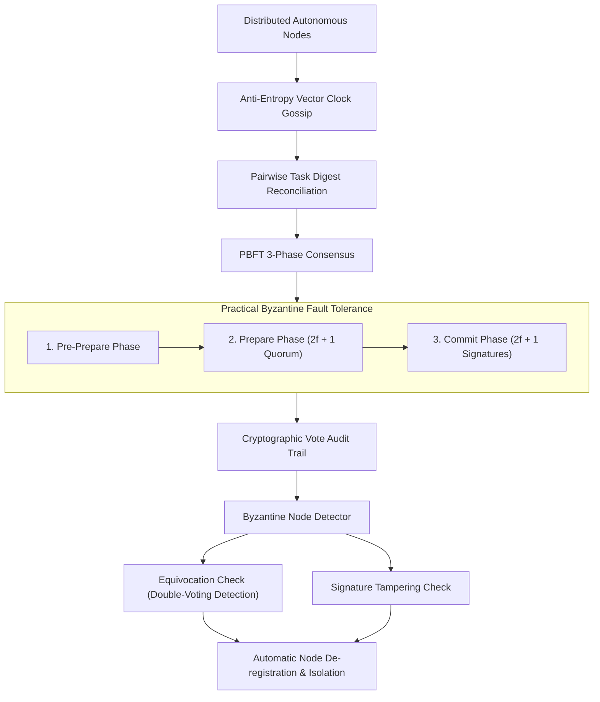

---

## 4. Master Subsystems Integration

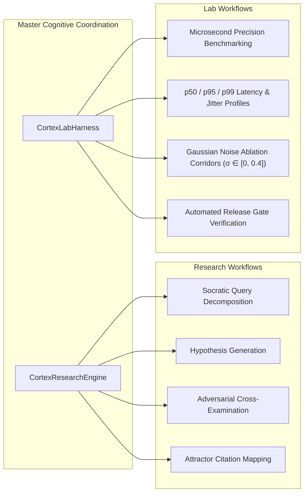

---
*Generated and validated for CORTEX-M Industrial Ecosystem Architecture.*
