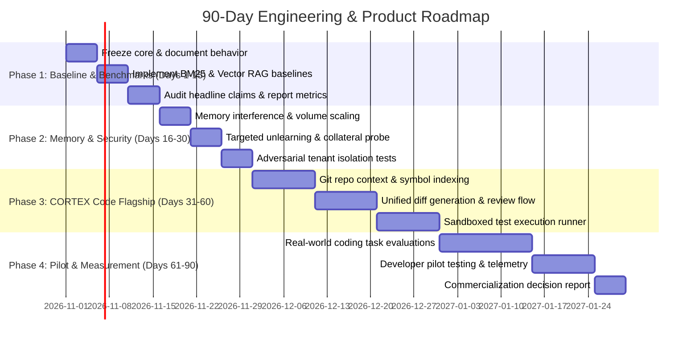

# CORTEX-M: Technical Evaluation, Use Cases, Flaws & Improvement Roadmap

> **Document Type:** Independent Architectural & Product Assessment  
> **Target:** CORTEX-M Neural Memory, Causal Routing, and Multi-Agent Swarm  
> **Source:** Technical Review & Strategic Analysis

---

## Executive Summary

CORTEX-M is an ambitious attempt to build a **memory-centric AI infrastructure layer** that combines associative memory, hallucination-aware responses, multi-agent coding, and a locally deployable AI interface. Rather than serving as an ordinary chatbot, it aims to remember, retrieve, evaluate, and use knowledge while coordinating specialized agents.

This evaluation distinguishes architectural strengths from claims that require independent empirical validation, identifies key structural flaws, proposes concrete engineering solutions, and outlines a practical 90-day execution roadmap.

---

## 1. What Exactly Has Been Built?

1. **A Memory-Centric AI Engine**:
   - Continuous Hopfield memory substrate with learned associations and iterative retrieval.
   - Hebbian-style online learning and anti-Hebbian-style unlearning.
   - Makes memory an active component of the reasoning pipeline rather than relying entirely on conventional vector databases.

2. **A Semantic Routing and Verification Layer**:
   - Causal MIMO router and factored gist representation.
   - Hierarchical routing designed to identify relevant information efficiently and distinguish meaningful inputs from scrambled or irrelevant perturbations.

3. **An Autonomous Coding-Agent System**:
   - Specialized persona division: Architect (design), Coder (synthesis), Critic (static analysis/review), and Auditor (security/sandbox testing).

4. **A Deployable AI Product**:
   - Cortex Studio web application, pure standard library REST APIs, SSE streaming, persisted configuration, sandboxed tools, and Python/npm packaging.
   - Foundation bridge connecting the memory substrate to external models (Ollama, vLLM, OpenAI, Anthropic).

---

## 2. Provisional Engineering & Product Potential Ratings

| Evaluation Dimension | Score | Assessment Rationale |
|---|---|---|
| **Architectural Ambition** | **9.0 / 10** | Unifies continuous Hopfield memory, causal routing, multi-agent swarms, and distribution. |
| **Research & Engineering Ambition** | **8.0 / 10** | High design potential as an infrastructure layer rather than a simple wrapper. |
| **Modularity & Extensibility** | **8.0 / 10** | Distinct subsystems, pluggable tools, and external model adapters. |
| **Developer Experience (DX)** | **8.0 / 10** | Studio UI, REST/SSE APIs, unified CLI, npm/pip/shell launch scripts. |
| **Research Originality** | **8.0 / 10** | Novel combination of associative memory, factored gist, and causal routing. |
| **Commercial Potential** | **8.0 / 10** | Strong enterprise niches in private knowledge, offline AI, and code synthesis. |
| **Testing Evidence** | **6.0 / 10** | 126 unit tests pass, but real-world retrieval coverage and test depth require proof. |
| **Memory Correctness** | **5.0 / 10** | Associative recall and targeted unlearning need realistic interference and scale testing. |
| **Hallucination Resistance** | **4.0 / 10** | Abstention is promising, but energy thresholds alone cannot establish factual truth. |
| **Security & Tenant Isolation** | **4.0 / 10** | Zero-leakage claims need adversarial, concurrent multi-tenant validation. |
| **Production Readiness** | **4.0 / 10** | Observability, request isolation under load, and disaster recovery unproven. |

---

## 3. Potential Application Verticals & Prioritization

```
Rank 1: AI Coding Assistant (Very High Fit) — Main Obstacle: Code correctness & safe execution
Rank 2: Research & Memory Experimentation (Very High Fit) — Main Obstacle: Reproducible benchmarks
Rank 3: Private Enterprise Knowledge Assistant (High Fit) — Main Obstacle: Retrieval precision & permissions
Rank 4: Offline / Edge AI Assistant (High Fit) — Main Obstacle: Native generation quality & hardware limits
Rank 5: Support & Service-Desk Copilot (High Fit) — Main Obstacle: Ticketing connectors & resolution quality
Rank 6: Regulated-Industry Compliance Assistant (Moderate–High Fit) — Main Obstacle: Immutable audit trails
```

---

## 4. Analysis of Flaws, Risks & Solutions

| Identified Flaw | Root Cause / Risk | Recommended Solution |
|---|---|---|
| **1. "Zero Hallucination" Claim** | Low energy indicates familiarity, not truth. False or poisoned memories recall with low energy. | Replace absolute claims with calibrated evidence states (`VERIFIED`, `PARTIAL`, `CONFLICTING`, `ABSTAIN`). |
| **2. Memory Interference** | Continuous Hopfield attractors suffer cross-talk as memory volume and similarity scale. | Benchmark recall scaling; implement deduplication and an authoritative fallback store. |
| **3. Unlearning Collateral Damage** | Subtracting outer products ($\Delta W = -\eta v v^T$) can degrade overlapping unrelated attractors. | Track fact provenance; measure deletion success and collateral damage separately. |
| **4. Inflated Performance Claims** | $14,000\times$ causal ratio results from near-zero denominator; $10^{-12}$ collision is theoretical. | Publish raw absolute deltas, sample sizes, confidence intervals, and public baselines. |
| **5. Native Language Model Limits** | Associative Hopfield retrieval cannot replace broad instruction-following foundation models. | Use native engine for associative memory and reasoning gating; bridge to external SLMs/LLMs for open-domain text. |
| **6. No External Database Tradeoff** | Pure weight memory complicates exact key lookups, transactions, and auditability. | Hybrid architecture: Associative memory for semantic priming + durable store for authoritative facts. |
| **7. Multi-Tenant Isolation Risks** | Rank-4 factors do not prevent cross-tenant data leaks in application code, caches, or prompts. | Enforce strict application-layer tenant authorization independent of model reasoning. |
| **8. Unsafe Agent Code Execution** | Autonomous code generation can execute destructive system calls or infinite loops. | Isolated subprocess sandbox, resource limits, 5-second timeouts, and human approval gates. |
| **9. Prompt-Injection Vulnerability** | Text normalization and quarantine buffers cannot guarantee LLMs ignore malicious instructions. | Treat all inputs/documents as untrusted; enforce permissions outside the model's context. |
| **10. Sparse Memory Pruning Uncertainty** | 86.7% sparsity target does not prove retrieval accuracy is preserved. | Compare recall accuracy, latency, and degradation curves before and after sleep pruning. |
| **11. Scaling Economics Misunderstanding** | 500,000 users/GB refers to dormant weight storage, not live concurrent active server sockets. | Clearly separate stored tenant capacity from active concurrent request throughput. |
| **12. Architectural Overcomplexity** | Simultaneously maintaining custom memory, routing, generation, and swarms creates debugging debt. | Modularize the core; hide experimental subsystems behind feature flags. |

---

## 5. Three Claims Under Critical Scrutiny

1. **"Zero Hallucination"**:
   - *Validation Requirement*: Evaluate energy-based uncertainty against actual factual correctness on benchmark datasets. Provide verifiable source attribution rather than claiming mathematical infallibility.
2. **"14,000× Clean-to-Scrambled Causality Ratio"**:
   - *Validation Requirement*: Report absolute error scores, variance, number of trials, and demonstrate route selection accuracy on out-of-distribution, unseen data.
3. **"500,000 Users per GB of RAM"**:
   - *Validation Requirement*: Acknowledge this as an arithmetic calculation of 2 KB tensor storage, not live concurrent user capacity. Benchmark active concurrent sessions, memory allocation, and p95/p99 latency under load.

---

## 6. Structural Architectural Improvements

### A. Hybrid Memory Architecture
```
┌────────────────────────────────────────────────────────┐
│               HYBRID COGNITIVE MEMORY                  │
├─────────────────────────┬──────────────────────────────┤
│ 1. Associative Memory   │ Rapid semantic priming,      │
│    (Continuous Hopfield)│ pattern completion, analogies│
├─────────────────────────┼──────────────────────────────┤
│ 2. Authoritative Store  │ Exact facts, versioning,     │
│    (Durable Records)    │ timestamps, verified sources │
├─────────────────────────┼──────────────────────────────┤
│ 3. Working Memory       │ Multi-turn dialog context,   │
│    (Ephemeral Buffer)   │ active goals and constraints │
└─────────────────────────┴──────────────────────────────┘
```

### B. Verifiable Evidence Pipeline
- Transition from scalar energy score to four discrete evidence states:
  - `VERIFIED`: Strong attractor convergence with confirmed source overlap.
  - `PARTIALLY_SUPPORTED`: Moderate resonance; partial semantic grounding.
  - `CONFLICTING_EVIDENCE`: Competing attractors with contradictory claims.
  - `INSUFFICIENT_EVIDENCE` (**ABSTAIN**): Energy out-of-bounds or zero attractor resonance.

### C. Hardened Coding Agent Swarm
- **Git Repository Context**: Scan and index local symbol tables.
- **Unified Diff Generation**: Output standard `diff -u` patches rather than whole-file overwrites.
- **Sandboxed Test Harness**: Run patch validation in isolated subprocess with strict execution timeouts.
- **Human Approval Gate**: Require explicit confirmation before modifying user project files.

---

## 7. Strategic Product Focus

**Primary Flagship**: **CORTEX Code** (AI Software Engineering Assistant)
- Best match for existing capabilities (Architect, Coder, Critic, Auditor).
- Delivers immediate, measurable value on real developer workflows.
- Serves as the real-world validation testbed for the underlying **CORTEX-M Memory SDK**.

---

## 8. 90-Day Execution Roadmap


