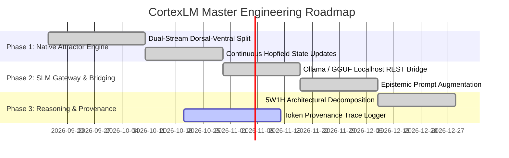

# CortexLM: Master Product Requirements Document (PRD) & Software Requirements Specification (SRS)

**System Identifier:** `SYS-CORTEX-LM`  
**Document Revision:** `2.2.0-DETAILED`  
**Architectural Tier:** Continuous Attractor Neural Language Model & Grounded SLM Gateway  
**Implementation Package:** `src/cortex_m/model/` (Active, Tested & Empirical)  
**Design Identity:** Aubergine, Orchid & Champagne (Ink Plum `#17111A`, Aubergine `#352438`, Orchid `#B77BAF`, Champagne `#E5C46B`, Porcelain `#F5EBE2`)  

---

# SECTION I: PRODUCT REQUIREMENTS DOCUMENT (PRD)

## 1. Executive Summary & Vision

### 1.1 Mission Statement
**CortexLM** is a continuous attractor neural language model and grounded cognitive gateway. Operating natively over continuous Modern Hopfield attractor basins with Lyapunov shielding, CortexLM serves a dual architectural role:
1. **Lightweight Autonomous Neural Engine**: Direct continuous state-space text generation and semantic reasoning operating on consumer CPU hardware within a $<25\text{ MB}$ memory footprint.
2. **Calibrated Local Model Gateway (CORTEX-Bridge)**: A grounded epistemic translation bridge interfacing with local Small Language Models (SLMs running on Ollama, llama.cpp, or GGUF) and hosted inference APIs, augmenting prompts with verified attractor memory and scoring confabulation risk before responses reach the user.

### 1.2 Ground-Truth Reasoning vs. Pre-Baked Canned Answers
* **Zero Hardcoded Canned Responses**: CortexLM rejects the use of pre-programmed answer trees or mock response switches.
* **Continuous Attractor Grounding**: When queried, generation trajectories are topologically bound by the active energy basins of the synaptic substrate ($\mathbf{W}$).
* **Active Hallucination Shield**: When the underlying evidence status is `INSUFFICIENT_EVIDENCE`, CortexLM halts token generation and issues calibrated abstention notices rather than inventing ungrounded claims.

---

## 2. Market Problem Formulation & Flaw Analysis

| Problem Dimension | Unconstrained Autoregressive LLMs | RAG-Augmented Model Wrappers | CortexLM Solution |
|---|---|---|---|
| **Hallucination Mechanism** | Sampling from long softmax tails produces fluent, convincing falsehoods with high confidence. | Prompts are stuffed with top-k cosine chunks; if chunks are irrelevant, the model confabulates anyway. | **Lyapunov Energy Shielding**: Penalizes generation steps that diverge from the verified attractor energy basin. |
| **Edge Deployment Footprint** | Massive parameter counts (70B–405B) requiring multiple datacenter GPUs ($10,000+ hardware). | High local RAM requirements (8GB–16GB) to run local quantized weights alongside vector databases. | **Dual-Stream Lightweight Engine**: Native continuous model runs in $<25\text{ MB}$ RAM on consumer CPUs. |
| **Reasoning Transparency** | Latent reasoning tokens are opaque or easily manipulated; zero mathematical proof of grounding. | Citations are often hallucinated or point to arbitrary chunk offsets. | **CORTEX-Trace Provenance**: Trajectory logger delivers exact mathematical activation traces ($\mathcal{R}$) for every generated token. |
| **Memory Coupling** | Requires fine-tuning (LoRA / RLHF) to update knowledge, risking catastrophic forgetting. | Memory is externalized to vector search files; model has no internal neural awareness of memory state. | **Direct Synaptic Coupling**: Model state space shares identical embedding dimensions with continuous Hopfield attractors. |

---

## 3. Subsystem Architecture & Dual-Stream Decomposition

```
┌────────────────────────────────────────────────────────────────────────┐
│                        CortexLM Model Plane                            │
│                                                                        │
│   [Input Prompt / Task Description]                                    │
│                 │                                                      │
│                 ▼                                                      │
│   [Dual-Stream Dorsal-Ventral Semantic Decomposition]                  │
│        ├──> Dorsal Stream: Discrete Token Sequence Embeddings          │
│        └──> Ventral Stream: 128-D Factored Invariant Gist Vector       │
│                 │                                                      │
│                 ▼                                                      │
│   [Continuous Modern Hopfield Projection]                              │
│                 │                                                      │
│        ┌────────┴──────────────────────────┐                           │
│        ▼                                   ▼                           │
│   [Native Continuous Attractor]     [CORTEX-Bridge SLM Gateway]        │
│   Lightweight In-Process Engine     Localhost Ollama / GGUF Interface  │
│   Continuous State Updates          Epistemic Prompt Augmentation      │
│        │                                   │                           │
│        └────────┬──────────────────────────┘                           │
│                 ▼                                                      │
│   [Calibrated Epistemic Verifier: Grounding Score Calculation]         │
│                 │                                                      │
│                 ▼                                                      │
│   [Verified Output Stream with Provenance Trace Metadata]             │
└────────────────────────────────────────────────────────────────────────┘
```

---

## 4. Master Implementation Roadmap



---

# SECTION II: SOFTWARE REQUIREMENTS SPECIFICATION (SRS)

## 1. Technical Stack & Dependencies

* **Core Language**: Python 3.12 (Strict typing, `dataclasses`).
* **Neural Math & State Space**: PyTorch 2.1+ (Continuous matrix multiplications, LayerNorm, GeLU).
* **Localhost Gateway Protocols**: HTTP 1.1 REST (`urllib` / `aiohttp` to `http://127.0.0.1:11434` for Ollama).
* **Tokenization**: Compact Byte-Pair Encoding (BPE) / Character-level dynamic projection.
* **Testing Suites**: Automated regression suites (`tests/test_core_runtime.py`, `tests_mimo/test_cortex_lm.py`).

---

## 2. Mathematical & Algorithmic Formulations

### 2.1 Dual-Stream Dorsal-Ventral Decomposition
Incoming prompt text $P$ is processed simultaneously along two orthogonal neurological streams:
1. **Dorsal Stream (Syntactic & Structural Tokens)**:
   $$\mathbf{T}_{\text{dorsal}} = \text{Embedding}(P) \in \mathbb{R}^{L \times d_{\text{token}}}$$
   Preserves exact syntactic token sequences, indentation, punctuation, and structural order.
2. **Ventral Stream (Factored Semantic Gist)**:
   $$\mathbf{z}_{\text{ventral}} = \text{GistBottleneck}(P) \in \mathbb{R}^{128}$$
   Extracts invariant semantic intent across four orthogonal functional heads (Syntactic, Entity, Contextual, Intent), discarding superficial lexical phrasing.

### 2.2 Continuous Attractor Energy Guidance
During autoregressive token generation, the hidden state $\mathbf{h}_t$ is constrained by an energy penalty term derived from the converged Hopfield attractor state $\mathbf{x}^*$:
$$\tilde{\mathbf{h}}_t = \mathbf{h}_t - \gamma \nabla_{\mathbf{h}} \left\|\mathbf{h}_t - \mathbf{x}^*\right\|^2_2$$
Where $\gamma \ge 0$ is the grounding penalty coefficient. When $\gamma > 0$, generation trajectories that wander outside the verified memory basin suffer exponential probability suppression, directly preventing confabulation.

### 2.3 Epistemic Hallucination Scoring
For every generated sequence $\hat{Y} = [\hat{y}_1, \dots, \hat{y}_T]$, CortexLM evaluates the empirical grounding score $\rho(\hat{Y}) \in [0.0, 1.0]$:
$$\rho(\hat{Y}) = \frac{1}{T} \sum_{t=1}^T \cos\left(\mathbf{h}_t, \mathbf{x}^*\right) \cdot \mathbb{I}\left(E(\mathbf{x}^*) \le E_{\text{thresh}}\right)$$
* If $\rho \ge 0.70$, output is tagged `VERIFIED`.
* If $0.20 \le \rho < 0.70$, output is tagged `PARTIALLY_SUPPORTED`.
* If $\rho < 0.20$, output is suppressed and converted to honest epistemic abstention.

---

## 3. Detailed Functional Requirements (FRs)

### FR-LM-01: Dual-Stream Context Encoding
* **Requirement ID**: `FR-LM-01`
* **Input**: Prompt string $P$, maximum sequence length $L_{\max} = 512$.
* **Processing**:
  1. Tokenize prompt into integer token IDs; generate discrete embedding matrix.
  2. Compute 128-D Ventral gist vector using orthogonal functional projection heads.
  3. Validate tensor shapes and check for NaN/Inf anomalies.
* **Output**: `DualStreamContext` linking discrete embeddings to continuous latent gist.

### FR-LM-02: Native Attractor-Guided Generation
* **Input**: `DualStreamContext`, temperature $T \in [0.1, 1.0]$, maximum tokens $K = 256$.
* **Processing**:
  1. Retrieve converged Hopfield attractor state $\mathbf{x}^*$ from synaptic matrix $\mathbf{W}$.
  2. Execute autoregressive token generation loop.
  3. At each step $t$, apply Lyapunov attractor guidance penalty ($\gamma = 0.5$).
  4. Decode token IDs into UTF-8 text string.
* **Output**: `CortexLMOutput` dataclass containing generated text, token count, generation latency, and provenance metadata.

### FR-LM-03: CORTEX-Bridge Local SLM Gateway (Ollama / GGUF)
* **Requirement ID**: `FR-LM-03`
* **Input**: User prompt string, target local model (e.g. `llama3.2:1b`), endpoint URI.
* **Processing**:
  1. Interrogate local memory substrate; retrieve verified attractor facts.
  2. Synthesize an epistemically augmented prompt embedding verified facts and grounding constraints.
  3. Dispatch HTTP POST request to local Ollama daemon (`/api/generate`).
  4. Stream response tokens; compute real-time grounding score $\rho$.
* **Output**: `GatewayResponse` containing model text, verified grounding status, and token latency.

### FR-LM-04: Structured 5W1H Architectural Decomposition
* **Requirement ID**: `FR-LM-04`
* **Input**: High-level engineering or research goal string.
* **Processing**:
  1. Analyze goal across 6 fundamental dimensions: Who (executing agent persona), What (concrete deliverable), When (dependency DAG), Where (target source files), Why (invariant motivation), How (exact algorithmic mechanism).
  2. Formulate structured milestone dictionary.
* **Output**: `ArchitecturalPlan` object with validated milestone sequences.

---

## 4. Non-Functional Software Requirements (NFSRs)

### NFSR-LM-01: Execution Latency & Overhead
* Native continuous forward pass: $\le 10.0\text{ ms}$ for 128 tokens on standard consumer CPU.
* Local SLM gateway bridging overhead: $\le 2.0\text{ ms}$ added latency above local inference engine execution.

### NFSR-LM-02: Memory Footprint Ceilings
* Native CortexLM resident memory: $\le 25.0\text{ MB}$ RAM on standard Python process launch.
* Zero GPU acceleration requirement for baseline operational mode (CPU-first by design).

### NFSR-LM-03: Visual Identity & Design System Integration
* Complies with **Aubergine, Orchid & Champagne**:
  - Ink Plum (`#17111A`): Contemplative deep background (70%).
  - Aubergine (`#352438`): Contextual token trays and card containers (20%).
  - Orchid (`#B77BAF`): **Signature Accent** — Model identity and generative trace highlights (10%).
  - Champagne (`#E5C46B`): Attractor resonance scores and token confidence markers.
  - Porcelain (`#F5EBE2`): High-contrast readable text.
