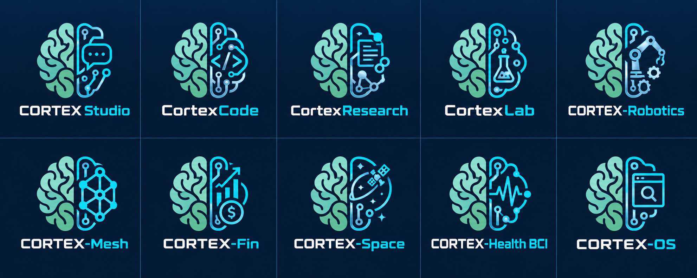

# CORTEX-M Industrial Platform Workstreams
### Specialized Production Lines Governed by the Master Ecosystem Implementation Plan

  

This directory houses the product surface implementations and simulation environments for the 8 specialized CORTEX-M product lines as governed by the [Master Ecosystem Implementation Plan](../docs/master_plan/cortex_m_original_ecosystem_implementation_plan.md).

---

## The 8 Industrial Platforms

| Platform | Workspace | Interface Preview | Qualification & Safety Standard |
|---|---|---|---|
| **CORTEX-IDE** | [`platforms/ide/`](ide/) | [View IDE UI](ide/) | Sandboxed Execution & Human Approval Gate |
| **CORTEX-Personal** | [`platforms/personal/`](personal/) | [View Assistant UI](personal/) | Private Tenant Isolation & Low-Rank Paging |
| **CORTEX-Fin** | [`platforms/fin/`](fin/) | [View Finance UI](fin/) | Shadow-Mode Isolation & Deterministic Ledgers |
| **CORTEX-OS** | [`platforms/os/`](os/) | [View OS UI](os/) | Userspace Sandbox & Semantic Affinity Clusters |
| **CORTEX-Robotics** | [`platforms/robotics/`](robotics/) | [View Robotics UI](robotics/) | ISO 10218-1/2:2025 Robotic Safety Standards |
| **CORTEX-Mesh** | [`platforms/mesh/`](mesh/) | [View Swarm UI](mesh/) | Civilian Transparent Protocols & BFT Consensus |
| **CORTEX-Health** | [`platforms/health/`](health/) | [View BCI UI](health/) | FDA Non-Clinical Guidance & IEC 62304 |
| **CORTEX-Space** | [`platforms/space/`](space/) | [View Space UI](space/) | NASA Flight Software Qualification (NPR 7150.2) |

---

## Architectural Principles
1. **Deterministic Safety Separation**: Neural associative inference supervises and proposes; hardware safety interlocks, financial ledgers, and medical state transitions remain deterministic.
2. **Simulation Before Hardware**: Robotics, Mesh, Health, and Space operate in high-fidelity software simulators before any physical hardware validation.
3. **Common Core Contracts**: All platforms communicate with the underlying runtime via [`cortex_m.core.contracts`](../src/cortex_m/core/contracts/).
