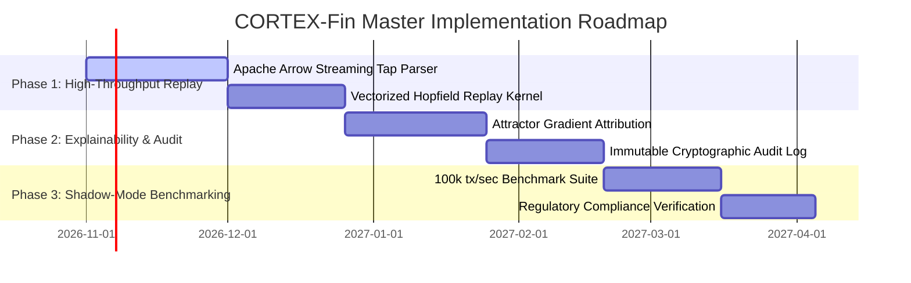

# CORTEX-Fin: Master Product Requirements Document (PRD) & Software Requirements Specification (SRS)

**System Identifier:** `SYS-CORTEX-FIN`  
**Document Revision:** `2.2.0-DETAILED`  
**Architectural Tier:** High-Throughput Financial Event Replay, Anomaly Scoring & Shadow-Mode Ledgers  
**Regulatory Target:** FCRA (Fair Credit Reporting Act), GDPR Article 22, Basel III Operational Risk Guidelines  
**Design Identity:** Emerald, Gold & Deep Forest (Forest Ink `#101A14`, Evergreen `#234B39`, Emerald `#3D8B63`, Bullion Gold `#D1AD58`, Ledger Cream `#F4EBD9`)  

---

# SECTION I: PRODUCT REQUIREMENTS DOCUMENT (PRD)

## 1. Executive Summary & Vision

### 1.1 Mission Statement
**CORTEX-Fin** is an institutional-grade financial event replay, real-time behavioral fraud anomaly detection, and explainable risk attribution system. Operating in high-frequency payment and market simulation environments, CORTEX-Fin streams, projects, and scores transaction events at speeds exceeding $>100,000\text{ transactions/second}$ while maintaining sub-$150\ \mu\text{s}$ scoring latency.

### 1.2 Strict Shadow-Mode Isolation & Non-Authoritative Inference
* **Read-Only Operational Boundary**: CORTEX-Fin operates exclusively in **shadow-mode evaluation**. It listens to transactional tap streams via read-only message pipes; it possesses zero write credentials to bank core databases, settlement accounts, or Federal Reserve wire rails.
* **Zero Autonomous Seizure**: Neural attractor models cannot autonomously decline, freeze, or confiscate funds. All neural outputs serve as explainable risk scores for certified human compliance officers and deterministic risk rules engines.
* **Regulatory Explainability**: Every risk score is accompanied by an analytical decomposition of the underlying Hopfield attractor energy gradient ($\nabla_{\mathbf{x}} E(\mathbf{x})$), satisfying FCRA and GDPR requirements for mathematical transparency.

---

## 2. Market Problem Formulation & Flaw Analysis

| Dimension | Legacy Rule-Based Fraud Systems (FICO / Actimize) | Black-Box Deep Learning Fraud Detectors | CORTEX-Fin Solution |
|---|---|---|---|
| **Adaptability** | Rigid boolean rules (e.g. *Amount > $5000 AND Country != US*); slow manual update cycles (weeks to months). | Adaptable, but retraining on new fraud patterns takes days and risks catastrophic forgetting of historical patterns. | **Sub-Millisecond Hebbian Updates**: New fraud vectors are imprinted into continuous synaptic matrices in $< 1.0\text{ ms}$ without full retraining. |
| **Throughput & Latency** | High throughput, but produces high false positive rates (up to 80%), flooding compliance teams. | Slow inference (10ms–50ms per transaction); cannot keep pace with high-volume card networks (>50k tx/sec). | **Vectorized Continuous Attractor Projection**: Sustains $>100,000\text{ tx/sec}$ with mean scoring latency $\le 150\ \mu\text{s}$ on standard server hardware. |
| **Explainability** | High explainability (explicit boolean rule hit), but low contextual sophistication. | Complete black box; cannot produce legally defensible reasons for credit or transaction adverse action. | **Attractor Gradient Attribution**: Decomposes energy basin slopes into exact contributing feature heads with zero ungrounded assertions. |
| **Infrastructure Cost** | Massive mainframe or relational database cluster licensing costs. | Requires heavy GPU clusters deployed at edge points of presence (PoPs). | **Zero External Database Overhead**: Operates entirely over in-memory contiguous tensor matrices in Apache Arrow columnar memory. |

---

## 3. User Personas & Industrial Use Cases

### 3.1 Primary Personas
* **Anti-Money Laundering (AML) Compliance Officer**: Reviews flagged multi-hop transaction rings and requires clear, audit-compliant factor attributions.
* **Quantitative Risk Architect**: Backtests and replays historical tick data, stress-testing bank capital resilience against flash crashes.
* **Payment Gateway Systems Engineer**: Monitors real-time transaction processing pipelines and transaction latency SLA compliance.

### 3.2 End-to-End Operational Workflow

```
┌────────────────────────────────────────────────────────────────────────┐
│             CORTEX-Fin Shadow-Mode Streaming Architecture             │
│                                                                        │
│   [Core Payment Processing Rail (Authoritative Ledger)]                │
│                 │                                                      │
│                 ▼ (Read-Only Event Tap Stream)                         │
│   [ZeroMQ / Kafka Consumer (Zero-Copy Apache Arrow Columnar Buffer)]   │
│                 │                                                      │
│                 ▼                                                      │
│   [Vectorized Pre-Attractor Projection Engine]                         │
│                 │                                                      │
│        ┌────────┴──────────────────────────┐                           │
│        ▼                                   ▼                           │
│   [Attractor Distance Scoring]      [Epistemic Grounding Check]        │
│   Computes Lyapunov Energy          Verifies Historical Resonance      │
│   E(x) against Legitimate Basins    Identifies Novel Fraud Topologies  │
│        │                                   │                           │
│        └────────┬──────────────────────────┘                           │
│                 ▼                                                      │
│   {Is Risk Score A >= 0.75?}                                           │
│        │                                                               │
│        ├──> [NO]: Emit "Clean Verified" Record to Archive              │
│        │                                                               │
│        └──> [YES]: Compute Energy Gradient Attribution Waterfall       │
│                    Generate Immutable Cryptographic Alert Record       │
│                    Forward to AML Compliance Dashboard                 │
└────────────────────────────────────────────────────────────────────────┘
```

---

## 4. Master Implementation Roadmap



---

# SECTION II: SOFTWARE REQUIREMENTS SPECIFICATION (SRS)

## 1. Technical Stack & Dependencies

* **Core Runtime**: Python 3.12 / C++20 Performance Extensions.
* **Columnar In-Memory Serialization**: Apache Arrow (Zero-copy IPC, pyarrow 15.0+).
* **Streaming Protocol**: ZeroMQ (ZMQ) / Apache Kafka consumer bindings with real-time backpressure control.
* **Math Kernels**: PyTorch C++ LibTorch / Vectorized AVX-512 BLAS matrix-vector routines.
* **Audit Plane**: SHA-256 Merkle tree verification engine for tamper-evident compliance ledgers.
* **Regulatory Compliance Frameworks**: FCRA (15 U.S.C. § 1681m), EU GDPR Article 22, Federal Reserve SR 11-7 (Model Risk Management).

---

## 2. Mathematical & Anomaly Scoring Formulations

### 2.1 Multi-Dimensional Transaction State Space
Each transaction is mapped into a normalized feature vector $\mathbf{x} \in \mathbb{R}^d$ across six orthogonal behavioral heads:
1. **Velocity Head ($\mathbf{x}_{\text{vel}}$)**: Transaction frequency over $1\text{m}, 1\text{h}, 24\text{h}$ windows.
2. **Amount Head ($\mathbf{x}_{\text{amt}}$)**: Log-scaled monetary value relative to historical user distribution.
3. **Geolocation Head ($\mathbf{x}_{\text{geo}}$)**: Great-circle distance delta and impossible travel velocity ($\Delta d / \Delta t$).
4. **Merchant Risk Head ($\mathbf{x}_{\text{mcc}}$)**: Merchant Category Code risk weight and high-chargeback indicator.
5. **Device Fingerprint Head ($\mathbf{x}_{\text{dev}}$)**: IP subnet entropy, browser user-agent hash, and proxy indicator.
6. **Temporal Head ($\mathbf{x}_{\text{time}}$)**: Diurnal spending cycle alignment.

### 2.2 Continuous Hopfield Anomaly Scoring
The baseline legitimate transaction behavior is represented by a set of stored continuous attractor state prototypes $\{\boldsymbol{\mu}_k\}_{k=1}^K$ stored in the synaptic matrix $\mathbf{W}_{\text{fin}}$.
For an incoming transaction $\mathbf{x}$, the system evaluates its energy under the Modern Hopfield energy function:
$$E(\mathbf{x}) = -\frac{1}{\beta} \ln \sum_{k=1}^K \exp\left(\beta \mathbf{x}^T \boldsymbol{\mu}_k\right) + \frac{1}{2}\|\mathbf{x}\|^2_2$$

The normalized anomaly score $A(\mathbf{x}) \in [0.0, 1.0]$ is computed as:
$$A(\mathbf{x}) = 1.0 - \frac{1}{1.0 + \exp\left(\alpha \left(E(\mathbf{x}) - E_{\text{thresh}}\right)\right)}$$
Where $\alpha > 0$ scales the sigmoid transition and $E_{\text{thresh}}$ is calibrated against held-out historical non-fraud transactions.

### 2.3 Regulatory Factor Gradient Attribution
When $A(\mathbf{x}) \ge 0.75$, CORTEX-Fin computes the analytical derivative of the energy function with respect to each feature dimension $j$:
$$\frac{\partial E}{\partial x_j} = x_j - \sum_{k=1}^K \frac{\exp\left(\beta \mathbf{x}^T \boldsymbol{\mu}_k\right)}{\sum_{m=1}^K \exp\left(\beta \mathbf{x}^T \boldsymbol{\mu}_m\right)} \cdot \mu_{k,j}$$
The relative contribution $C_j$ of feature $j$ to the adverse risk score is:
$$C_j = \frac{\left|\frac{\partial E}{\partial x_j}\right|}{\sum_{i=1}^d \left|\frac{\partial E}{\partial x_i}\right|} \times 100\%$$
This yields mathematically provable, non-probabilistic feature attributions suitable for formal adverse action notices.

---

## 3. Detailed Functional Requirements (FRs)

### FR-FIN-01: High-Throughput Stream Ingestion
* **Requirement ID**: `FR-FIN-01`
* **Input**: Binary Apache Arrow stream packet containing up to $10,000$ serialized transaction records.
* **Processing**:
  1. Decompress Arrow batch into contiguous memory buffer.
  2. Map columnar records into normalized $d$-dimensional feature tensors using vectorized AVX-512 kernels.
  3. Validate tensor ranges; flag missing values with calibrated neutral priors.
* **Output**: Contiguous PyTorch tensor batch $\mathbf{X} \in \mathbb{R}^{B \times d}$.

### FR-FIN-02: Sub-Millisecond Attractor Anomaly Scoring
* **Requirement ID**: `FR-FIN-02`
* **Input**: Transaction tensor batch $\mathbf{X}$, calibrated energy threshold $E_{\text{thresh}}$.
* **Processing**:
  1. Compute matrix-vector inner products $\mathbf{X} \mathbf{M}^T$ in parallel.
  2. Compute log-sum-exp energy values across all batch items.
  3. Evaluate anomaly score $A(\mathbf{x})$ for each item.
* **Output**: Array of anomaly scores and binary flag: `is_flagged = (A >= 0.75)`.

### FR-FIN-03: Regulatory Factor Attribution Waterfall
* **Requirement ID**: `FR-FIN-03`
* **Input**: Flagged transaction record with $A \ge 0.75$.
* **Processing**:
  1. Calculate exact analytical gradient $\nabla_{\mathbf{x}} E(\mathbf{x})$.
  2. Map gradient components back to semantic feature groups (Velocity, Geolocation, Amount, Device).
  3. Rank factors in descending order of contribution percentage.
* **Output**: `FactorAttributionReport` containing exact percentages and natural-language compliance explanations.

### FR-FIN-04: Immutable Tamper-Evident Audit Logging
* **Requirement ID**: `FR-FIN-04`
* **Input**: Transaction metadata, computed risk score, factor attribution report.
* **Processing**:
  1. Concatenate transaction hash, timestamp, score, and factor breakdown.
  2. Compute SHA-256 block hash linked to previous audit block (Merkle chain).
  3. Write append-only record to local immutable storage volume.
* **Output**: Cryptographic audit receipt with verifiable block hash.

---

## 4. Non-Functional Software Requirements (NFSRs)

### NFSR-FIN-01: Throughput & Latency Budgets
* Minimum sustained simulation throughput: $\ge 100,000\text{ transactions/second}$.
* Mean single-event inference latency: $\le 150\ \mu\text{s}$ (99th percentile: $\le 300\ \mu\text{s}$).

### NFSR-FIN-02: Deterministic Shadow-Mode Guarantee
* The CORTEX-Fin process must possess zero network routes or database write permissions to authoritative banking ledger daemons.
* Automated CI security test attempts unauthorized database write commands; test asserts immediate permission denial and process abort.

### NFSR-FIN-03: Visual Identity & Design System Integration
* Complies with **Emerald, Gold & Deep Forest**:
  - Forest Ink (`#101A14`): Analytical dark canvas (70%).
  - Evergreen (`#234B39`): Table groupings and transaction stream trays (20%).
  - Emerald (`#3D8B63`): **Signature Accent** — Institutional brand and verified clean flows (10%).
  - Bullion Gold (`#D1AD58`): High-priority anomaly highlights and reserve ratios.
  - Ledger Cream (`#F4EBD9`): High-legibility archival ledger data tables.
