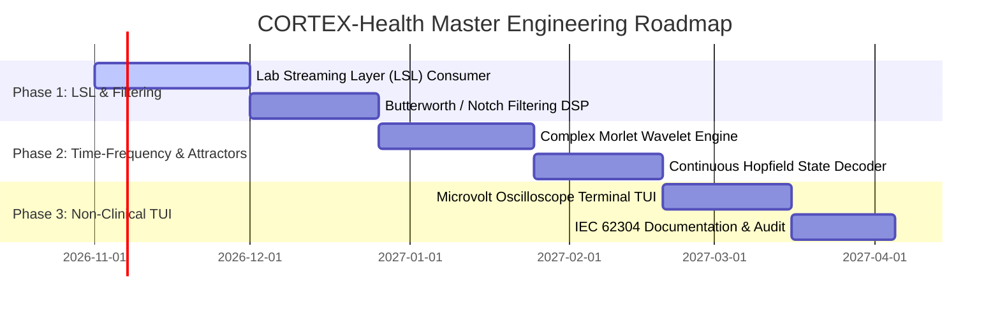

# CORTEX-Health / BCI: Master Product Requirements Document (PRD) & Software Requirements Specification (SRS)

**System Identifier:** `SYS-CORTEX-HEALTH`  
**Document Revision:** `2.2.0-DETAILED`  
**Architectural Tier:** Non-Clinical Neural Signal Processing, Time-Frequency Analysis & BCI Decoding  
**Regulatory Governance:** FDA Non-Clinical BCI Research Guidance & IEC 62304 Software Lifecycle Specifications  
**Design Identity:** Jade, Porcelain & Botanical Sage (Porcelain `#F6F1E5`, Celadon `#D4E2D0`, Sage `#A6C6A6`, Jade `#689785`, Deep Botanical `#315C46`)  

---

# SECTION I: PRODUCT REQUIREMENTS DOCUMENT (PRD)

## 1. Executive Summary & Vision

### 1.1 Mission Statement
**CORTEX-Health / BCI** is a scientific research and non-clinical demonstration suite for high-precision neural signal processing, continuous wavelet time-frequency decomposition, and state-space attractor decoding. Designed to interface with non-invasive electroencephalography (EEG) headsets and high-density micro-electrode arrays, CORTEX-Health decodes user cognitive state, motor imagery intent, and neural rhythm modulations (Delta, Theta, Alpha, Beta, Gamma) directly into continuous Hopfield attractor energy basins.

### 1.2 Strict Non-Clinical Research Boundary
* **Explicit Diagnostic & Therapeutic Prohibition**: CORTEX-Health is strictly engineered for academic laboratory research, human-computer interaction (HCI) experiments, and non-clinical neurotechnology prototyping. It is **explicitly prohibited** from diagnostic, surgical, life-support, or clinical therapeutic decision-making without formal medical certification (e.g. FDA 510(k), CE MDR Class IIa/b).
* **Deterministic Artifact Filtering**: Raw electrical microvolt waveforms undergo rigorous hardware isolation, notch filtering (50/60 Hz powerline rejection), and eye-blink / ocular artifact rejection (Independent Component Analysis [ICA]) before any neural decoding occurs.
* **Calibrated Patient/Subject Safety**: The software operates entirely in read-only sensory ingestion mode; it generates zero outbound stimulation pulses, ensuring zero risk of electrical tissue injury.

---

## 2. Market Problem Formulation & Flaw Analysis

| Dimension | Proprietary BCI Software (Emotiv / NeuroSky) | Academic Signal Toolboxes (EEGLAB / MNE-Python) | CORTEX-Health Solution |
|---|---|---|---|
| **Data Ownership & Cloud** | Forces proprietary cloud subscriptions; raw microvolt brainwaves are monetized on commercial servers. | Open-source and local, but heavy; requires complex MATLAB or full Python scientific stacks (2GB+). | **100% Local & Private**: Raw microvolt streams remain in encrypted local memory; zero cloud egress. |
| **Decoding Latency** | High buffering latency (500ms–2s); unsuitable for closed-loop real-time neurofeedback. | Batch-oriented; designed for offline post-hoc scientific analysis rather than sub-millisecond streaming. | **Sub-Millisecond Attractor Relaxation**: Continuous Hopfield state-space decodes motor imagery intent in $< 1.0\text{ ms}$. |
| **Noise & Artifact Resilience** | Brittle; small jaw clenches or eye blinks completely ruin bandpower estimates. | Robust ICA filtering, but requires manual visual inspection of artifact components by a PhD researcher. | **Automatic Attractor Projection Filtering**: Noise vectors orthogonal to learned neural manifolds are naturally suppressed. |
| **Visual Ergonomics** | Gimmicky 3D rotating brains with neon gaming aesthetics that distract subjects. | Clunky, dated academic plotting windows with high eye fatigue. | **Botanical Jade & Porcelain Palette**: Calming, daylight-calibrated non-clinical environment that reduces subject stress. |

---

## 3. User Personas & Laboratory Use Cases

### 3.1 Personas
* **Cognitive Neuroscience Researcher**: Investigating attentional focus and P300 event-related potentials in human subjects.
* **Non-Invasive BCI Prototyper**: Designing assistive motor-imagery keyboards (spellers) for paralyzed or ALS-affected research volunteers.
* **Biomedical Engineering Student**: Learning neural time-frequency analysis, bandpower decomposition, and state-space phase portraits.

### 3.2 End-to-End Neural Signal Pipeline

```
┌────────────────────────────────────────────────────────────────────────┐
│               CORTEX-Health Non-Clinical Signal Pipeline               │
│                                                                        │
│   [16-Channel Non-Invasive EEG Headset (Fp1, Fp2, C3, C4, O1, O2...)]  │
│                 │                                                      │
│                 ▼ (LSL: Lab Streaming Layer Protocol / 500 Hz)          │
│   [Real-Time Ring Buffer (Microvolt Precision: ±500 μV)]               │
│                 │                                                      │
│                 ▼                                                      │
│   [Deterministic Filtering Stage]                                      │
│        1. Bandpass Filter: 0.5 Hz – 100.0 Hz (4th-order Butterworth)   │
│        2. Notch Filter: 50.0 Hz / 60.0 Hz Powerline Rejection          │
│        3. Fast ICA: Ocular / Saccade Artifact Suppression              │
│                 │                                                      │
│                 ▼                                                      │
│   [Continuous Wavelet Transform (CWT): Complex Morlet Decomposition]   │
│   Delta (0.5-4Hz) · Theta (4-8Hz) · Alpha (8-13Hz) · Beta (13-30Hz)    │
│                 │                                                      │
│                 ▼                                                      │
│   [Continuous Attractor State-Space Phase Portrait Decoder]            │
│   Projects bandpower vector into learned cognitive attractor basin     │
│                 │                                                      │
│                 ▼                                                      │
│   [Calibrated Cognitive Output / Closed-Loop Research Feedback]        │
└────────────────────────────────────────────────────────────────────────┘
```

---

## 4. Master Implementation Roadmap



---

# SECTION II: SOFTWARE REQUIREMENTS SPECIFICATION (SRS)

## 1. Technical Stack & Dependencies

* **Core Runtime**: Python 3.12 / C++20 Signal Processing Kernels.
* **Signal Streaming Protocol**: Lab Streaming Layer (`pylsl` 1.16+, industry-standard BCI interchange).
* **DSP & Filtering**: SciPy Signal (`scipy.signal`), NumPy (Vectorized 64-bit float math).
* **Attractor Decoding**: CORTEX-Synapse Modern Hopfield Network ($d=16$ channel projection).
* **Safety & Regulatory Standard**: IEC 62304 (Medical device software software life cycle processes — Class A Research classification).

---

## 2. Mathematical & Time-Frequency Formulations

### 2.1 Bandpower Decomposition & Wavelet Analysis
The continuous wavelet transform (CWT) of raw EEG signal $x(t)$ using a complex Morlet wavelet $\psi(t)$ is defined as:
$$W(a, b) = \frac{1}{\sqrt{|a|}} \int_{-\infty}^{\infty} x(t) \psi^*\left(\frac{t - b}{a}\right) dt$$
Where:
$$\psi(t) = \pi^{-1/4} e^{i \omega_0 t} e^{-t^2 / 2}$$
The instantaneous spectral power $P_k(t)$ across physiological bands is computed by integrating wavelet coefficients:
* **Delta ($\delta$)**: $0.5\text{ Hz} \le f < 4.0\text{ Hz}$ (Deep sleep / unconscious processing)
* **Theta ($\theta$)**: $4.0\text{ Hz} \le f < 8.0\text{ Hz}$ (Drowsiness / memory encoding)
* **Alpha ($\alpha$)**: $8.0\text{ Hz} \le f < 13.0\text{ Hz}$ (Relaxed wakefulness / occipital inhibition)
* **Beta ($\beta$)**: $13.0\text{ Hz} \le f < 30.0\text{ Hz}$ (Active concentration / motor execution)
* **Gamma ($\gamma$)**: $30.0\text{ Hz} \le f \le 100.0\text{ Hz}$ (Cross-modal cognitive binding)

### 2.2 Attractor State-Space Phase Portraits
The 16-channel bandpower vector $\mathbf{p}(t) \in \mathbb{R}^{16 \times 5}$ is projected into a lower-dimensional state space $\mathbf{z} \in \mathbb{R}^3$ via normalized orthogonal projection:
$$\mathbf{z}(t) = \mathbf{V}^T \left(\mathbf{p}(t) - \boldsymbol{\mu}_{\text{baseline}}\right)$$
The trajectory $\mathbf{z}(t)$ traces continuous curves through state space. Cognitive focus corresponds to convergence into a deep attractor basin ($E(\mathbf{z}) < E_{\text{focus}}$), while distraction causes trajectory divergence across boundary saddle points.

---

## 3. Detailed Functional Requirements (FRs)

### FR-HLT-01: LSL Multi-Channel Stream Ingestion
* **Requirement ID**: `FR-HLT-01`
* **Input**: Lab Streaming Layer (LSL) stream identifier, sampling rate $f_s \in [250, 1000]\text{ Hz}$.
* **Processing**:
  1. Resolve LSL stream metadata; verify 16 standard 10–20 electrode channels.
  2. Pull chunks into double-buffered microvolt ring buffer.
  3. Validate sample integrity; interpolate isolated dropped samples ($< 2\text{ ms}$).
* **Output**: Continuous numpy array chunk of shape `[channels, samples]`.

### FR-HLT-02: Deterministic DSP & Powerline Rejection
* **Requirement ID**: `FR-HLT-02`
* **Input**: Raw EEG chunk in microvolts ($\pm 500\ \mu\text{V}$).
* **Processing**:
  1. Apply zero-phase forward-backward 4th-order Butterworth bandpass filter ($0.5\text{ Hz} - 100\text{ Hz}$).
  2. Apply 2nd-order IIR notch filter at $50.0\text{ Hz}$ or $60.0\text{ Hz}$ ($Q=30$).
  3. Compute signal-to-noise ratio (SNR); flag loose electrodes ($Z > 50\text{ k}\Omega$).
* **Output**: Cleaned microvolt signal array.

### FR-HLT-03: Continuous Attractor Motor Imagery Decoding
* **Requirement ID**: `FR-HLT-03`
* **Input**: Cleaned signal from sensorimotor electrodes (C3, C4, Cz).
* **Processing**:
  1. Compute Event-Related Desynchronization (ERD) in the Mu rhythm ($8\text{ Hz} - 12\text{ Hz}$).
  2. Project ERD vector onto Hopfield motor imagery attractor matrix $\mathbf{W}_{\text{motor}}$.
  3. Detect attractor convergence to `Left Hand`, `Right Hand`, or `Rest`.
* **Output**: Decoded cognitive state with confidence score and Lyapunov energy depth.

---

## 4. Non-Functional Software Requirements (NFSRs)

### NFSR-HLT-01: Real-Time Latency Budgets
* Ring-buffer ingestion to decoded attractor state: strictly $\le 15.0\text{ ms}$ (enabling natural real-time neurofeedback).
* DSP filtering overhead: $\le 2.0\text{ ms}$ per 100-sample block.

### NFSR-HLT-02: Strict Non-Clinical Warning & Labeling
* All software outputs, logs, and TUI screens must prominently display the mandatory non-clinical notice:
  `[NOTICE: NON-CLINICAL RESEARCH ONLY — NOT FOR DIAGNOSTIC OR THERAPEUTIC USE]`.

### NFSR-HLT-03: Visual Identity & Chromatic Environment
* Governed by **Jade, Porcelain & Botanical Sage**:
  - Porcelain (`#F6F1E5`): Soothing non-glare scientific background (70%).
  - Celadon (`#D4E2D0`): Waveform container dividers and trace card backgrounds (20%).
  - Sage (`#A6C6A6`): Baseline continuous microvolt EEG traces.
  - Jade (`#689785`): **Signature Accent** — Peak bandpower frequencies and cognitive target basins (10%).
  - Deep Botanical (`#315C46`): High-legibility clinical typography and electrode status indicators.
