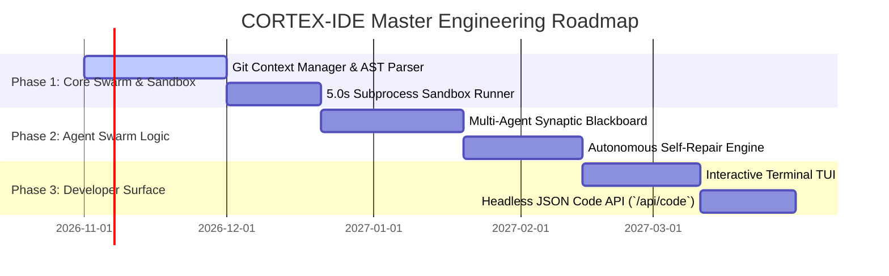
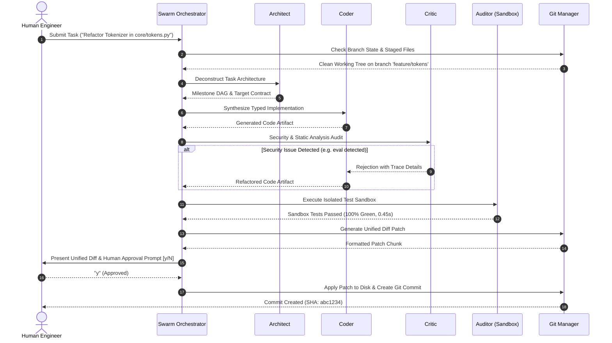

# CORTEX-IDE / CortexCode: Master Product Requirements Document (PRD) & Software Requirements Specification (SRS)

**System Identifier:** `SYS-CORTEX-IDE`  
**Document Revision:** `2.2.0-DETAILED`  
**Architectural Tier:** Autonomous Repository Engineering, AST Refactoring & Sandboxed Execution  
**Execution Runtime:** Headless CLI / JSON API / Git Workspace Supervisor  
**Design Identity:** Forest Graphite & Fern (Editor Ink `#171A17`, Forest Graphite `#29332C`, Fern `#8EBF76`, Debug Brass `#E7AF63`, Linen `#F0F1E8`)  

---

# SECTION I: PRODUCT REQUIREMENTS DOCUMENT (PRD)

## 1. Executive Summary & Vision

### 1.1 Mission Statement
**CORTEX-IDE** (powered by the **CortexCode** autonomous engineering multi-agent swarm) is a repository-aware autonomous software engineering workspace. Unlike conventional commercial code assistants that operate as naive auto-complete buffers or hallucinate untested syntax blocks across arbitrary files, CortexCode operates as an integrated multi-agent engineering team: it analyzes live Git branch topologies, parses complete Abstract Syntax Tree (AST) symbol call graphs, synthesizes typed and docstring-annotated patches, executes test suites inside a hard $5.0$-second subprocess sandbox, and enforces deterministic human approval gates before writing changes to disk or committing to Git.

### 1.2 Ground-Truth Tabula Rasa Engineering Principle
* **Zero Hardcoded Canned Solutions**: CortexCode contains zero hardcoded algorithmic templates (e.g. no pre-canned LRU caches, binary searches, or quicksort switches).
* **Dynamic Grounded Synthesis**: Every program, function, and refactoring plan is synthesized dynamically from the user's task requirements, existing workspace type signatures, and learned synaptic memories.
* **Empirical Validation**: Code is never declared finished based on model confidence; it must pass AST syntax parsing, security audit inspection, and empirical test execution inside the sandbox.

---

## 2. Market Problem Formulation & Flaw Analysis

| Problem Dimension | Commercial AI Code Assistants (Copilot / Cursor) | Agentic Code Wrappers (AutoGPT / OpenDevin) | CortexCode / CORTEX-IDE Solution |
|---|---|---|---|
| **Repository Context** | Limited to small context windows (8k–32k tokens); loses global architecture awareness in large monorepos. | Dumps thousands of raw file tokens into prompt; hits token limits and generates ungrounded edits. | **AST Symbol Table & Call Graph**: Indexes classes, functions, and cross-file dependencies directly into associative memory. |
| **Patch Application** | Often rewrites entire 2,000-line files to change 3 lines, introducing unintended diffs and destroying comments. | Unreliable line matching; produces invalid unified diff chunks that fail to apply via `git apply`. | **Surgical AST-Validated Diffs**: Generates precise unified diff chunks with AST integrity checks and comment preservation. |
| **Execution Safety** | Emits code directly into editor buffers without running tests; user acts as the manual debugger. | Executes arbitrary commands on user shell without sandboxing, risking accidental data loss or rm -rf. | **5.0s Isolated Subprocess Sandbox**: Runs tests with sanitized environment variables, memory limits, and hard execution timeouts. |
| **Human Governance** | Modifies files on disk silently; user must manually review `git diff` to discover changes. | Auto-commits and auto-pushes untested branches without explicit human verification. | **Deterministic Approval Gates**: Requires explicit human cryptographic confirmation (`[y/N]`) before disk mutation or git push. |

---

## 3. Autonomous Multi-Agent Swarm Personas

```
┌────────────────────────────────────────────────────────────────────────┐
│                    CORTEX-IDE Multi-Agent Swarm                        │
│                                                                        │
│   ┌────────────────────┐                     ┌─────────────────────┐   │
│   │  Architect Persona │                     │    Coder Persona    │   │
│   │  5W1H DAG Planning │────────────────────>│    AST Synthesis    │   │
│   └────────────────────┘                     └──────────┬──────────┘   │
│                                                         │              │
│                                                         ▼              │
│   ┌────────────────────┐                     ┌─────────────────────┐   │
│   │   Auditor Persona  │                     │   Critic Persona    │   │
│   │ 5.0s Sandbox Runner│<────────────────────│ Security & AST Audit│   │
│   └─────────┬──────────┘                     └─────────────────────┘   │
│             │                                                          │
│             ▼                                                          │
│   ┌────────────────────────────────────────────────────────────────┐   │
│   │  Deterministic Human Approval Gate: Unified Diff Review [y/N]  │   │
│   └────────────────────────────────────────────────────────────────┘   │
└────────────────────────────────────────────────────────────────────────┘
```

### 3.1 Persona Roles & Responsibilities
1. **Architect Persona**: Deconstructs user requirements into a 5W1H milestone DAG (Directed Acyclic Graph), identifying exact target files and interface contracts.
2. **Coder Persona**: Formulates typed, idiomatic code satisfying AST specifications and architectural invariants.
3. **Critic Persona**: Performs static security audits, identifies unsafe dynamic execution patterns (`eval`, `exec`, bare exceptions), and enforces docstring completeness.
4. **Auditor Persona**: Orchestrates the 5.0-second subprocess test sandbox, captures runtime tracebacks, and drives autonomous self-repair if assertions fail.

---

## 4. Master Implementation Roadmap



---

# SECTION II: SOFTWARE REQUIREMENTS SPECIFICATION (SRS)

## 1. Technical Stack & Dependencies

* **Core Runtime**: Python 3.12 (Strict typing, `typing.NamedTuple`, `dataclasses`).
* **AST & Code Analysis**: Built-in Python `ast`, `symtable`, `dis`, and `tokenize` libraries.
* **Version Control Interface**: Git CLI (v2.30+) invoked via subprocess with sanitized argument escaping.
* **Sandboxing**: Python `subprocess.Popen` with OS-level process group separation (`os.setpgrp`), virtual memory rlimits (`resource.setrlimit`), and memory ceilings.
* **Diff Engine**: Python `difflib.unified_diff` with custom AST-aware chunk validator.

---

## 2. Component Flow & Sequence Diagram



---

## 3. Functional Requirements (FRs)

### FR-IDE-01: Git Context & Workspace Symbol Indexing
* **Requirement ID**: `FR-IDE-01`
* **Input**: Workspace root path.
* **Processing**:
  1. Inspect Git status: branch name, uncommitted changes, untracked files.
  2. Recursively scan `.py` files (ignoring `.git`, `__pycache__`, `.venv`).
  3. Parse each file into an AST; extract class names, method signatures, parameter types, return types, and docstrings.
  4. Construct global symbol dependency graph.
* **Output**: `WorkspaceContext` containing Git status and symbol table dictionary.

### FR-IDE-02: Multi-Role Autonomous Planning & Synthesis
* **Requirement ID**: `FR-IDE-02`
* **Input**: User task prompt, `WorkspaceContext`.
* **Processing**:
  1. Architect persona generates 5W1H DAG milestones.
  2. Coder persona synthesizes complete, syntactically valid Python code.
  3. Validates syntax via `ast.parse()`; rejects any incomplete code blocks or markdown wrapping artifacts.
* **Output**: `CodeArtifact` containing verified code string, parsed AST tree, and extracted function list.

### FR-IDE-03: Static Security & Critic Inspection
* **Requirement ID**: `FR-IDE-03`
* **Input**: `CodeArtifact`.
* **Processing**:
  1. Inspect AST for forbidden nodes (`ast.Call` invoking `eval`, `exec`, or `os.system`).
  2. Flag bare `except:` clauses; verify explicit typing.
  3. Compute security risk score: $R \in [0.0, 1.0]$.
  4. If $R > 0.0$, reject artifact with actionable defect remediation guidance.
* **Output**: `CodeReview` object with boolean approval and suggestions.

### FR-IDE-04: 5.0-Second Isolated Subprocess Sandbox Runner
* **Requirement ID**: `FR-IDE-04`
* **Input**: Generated test script or unit test invocation command.
* **Processing**:
  1. Create temporary directory sandbox.
  2. Write proposed code artifact into isolated environment.
  3. Spawn child process with sanitized environment (stripping API keys and write access to external directories).
  4. Set execution timer with hard real-time ceiling ($5.0\text{ seconds}$).
  5. If child exceeds timeout, send `SIGKILL` to entire process group.
* **Output**: `SandboxResult` containing return code, stdout, stderr, execution duration, and timeout status.

### FR-IDE-05: Autonomous Self-Repair Engine
* **Requirement ID**: `FR-IDE-05`
* **Input**: `SandboxResult` with non-zero return code or traceback.
* **Processing**:
  1. Parse traceback to extract exact failing line number, error type (`AssertionError`, `TypeError`, `IndexError`), and error message.
  2. Formulate diagnostic prompt back to Coder persona.
  3. Synthesize targeted correction patch.
  4. Re-execute sandbox (up to 3 automated repair iterations).
* **Output**: Repaired `CodeArtifact` or terminal escalation to human engineer.

### FR-IDE-06: Deterministic Human Approval Gate
* **Requirement ID**: `FR-IDE-06`
* **Input**: Verified patch, unified diff.
* **Processing**:
  1. Display colorized side-by-side or unified diff.
  2. Present interactive terminal prompt: `[CortexCode] Apply patch to disk and commit? [y/N]: `.
  3. Await explicit positive confirmation (`y` or `yes`). Any negative, blank, or unexpected input aborts operation immediately with zero disk mutation.
* **Output**: Boolean approval result; logged event.

---

## 4. Non-Functional Software Requirements (NFSRs)

### NFSR-IDE-01: Sandboxing Ceilings & Timeouts
* Maximum test execution duration: strictly capped at $5.00\text{ seconds}$.
* Virtual memory limit per sandbox run: $\le 512.0\text{ MB}$.
* Disk temporary workspace quota: $\le 50.0\text{ MB}$.

### NFSR-IDE-02: Self-Repair Cycle Bound
* Automated self-repair iterations: strictly bounded to $\le 3$ attempts. If tests still fail after 3 attempts, the system must halt and present the raw trace to the human engineer.

### NFSR-IDE-03: Visual Identity & Chromatic Environment
* Governed by **Forest Graphite & Fern**:
  - Editor Ink (`#171A17`): Deep non-glare background (70%).
  - Forest Graphite (`#29332C`): File trees, diff gutters, and frame borders (20%).
  - Fern (`#8EBF76`): **Signature Accent** — Unified diff additions (`+`), passing tests, and AST symbols (10%).
  - Debug Brass (`#E7AF63`): Unified diff deletions (`-`), test warnings, and approval prompts.
  - Linen (`#F0F1E8`): High-contrast monospace code text.
