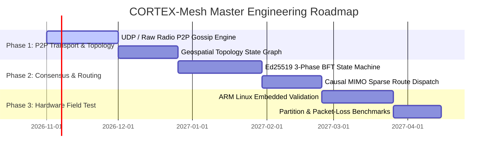

# CORTEX-Mesh: Master Product Requirements Document (PRD) & Software Requirements Specification (SRS)

**System Identifier:** `SYS-CORTEX-MESH`  
**Document Revision:** `2.2.0-DETAILED`  
**Architectural Tier:** Decentralized Swarm Coordination & Byzantine Fault Tolerant (BFT) Routing  
**Operational Scope:** Civilian Cooperative Logistics, Disaster Search-and-Rescue & Sensor Swarms  
**Design Identity:** Moss, Lichen & Signal Lime (Forest Night `#101810`, Moss `#2E4B34`, Lichen Green `#729775`, Signal Lime `#CBE86B`, Parchment `#F1EBD7`)  

---

# SECTION I: PRODUCT REQUIREMENTS DOCUMENT (PRD)

## 1. Executive Summary & Vision

### 1.1 Mission Statement
**CORTEX-Mesh** is a decentralized peer-to-peer cognitive routing and swarm consensus architecture designed for fleets of Autonomous Guided Vehicles (AGVs), civilian disaster search-and-rescue aerial/ground rovers, and dense environmental sensor networks. By coupling CORTEX-Router causal sparse routing with a transparent Byzantine Fault Tolerant (BFT) state machine, CORTEX-Mesh maintains multi-node consensus, load-balanced task allocation, and associative route memory over high-latency, intermittent, and packet-loss-prone radio links.

### 1.2 Civilian Transparency & Defensive Safety Invariant
* **Strict Civilian Logistics Boundary**: CORTEX-Mesh is formulated exclusively for open, cooperative, civilian use cases—including humanitarian food/medicine delivery swarms, warehouse pallet logistics, and wildfire environmental sensor grids.
* **Transparent Verifiable Consensus**: Zero opaque or proprietary encryption protocols that obscure routing intent. All consensus proposals, route traces, and node states are cryptographically signed using Ed25519 and logged to an open, auditable state stream.
* **Anti-Adversarial Fallback**: In the presence of partitioned or Byzantine malicious nodes, CORTEX-Mesh falls back to localized low-rank consensus subsets without stalling overall logistics flow.

---

## 2. Market Problem Formulation & Flaw Analysis

| Problem Dimension | Centralized Fleet Management (AWS IoT / Cloud Fleet) | Conventional Mesh Routing (B.A.T.M.A.N. / OLSR) | CORTEX-Mesh Solution |
|---|---|---|---|
| **Single Point of Failure** | Total outage if cellular / satellite link to cloud breaks; robots freeze in place. | Decentralized, but operates strictly at packet level (L2/L3); zero cognitive awareness of task semantics. | **Decentralized Cognitive Consensus**: Swarm negotiates task allocation locally; zero reliance on central cloud servers. |
| **Routing Adaptability** | Central server recalculates global paths; introduces 500ms–5s network round-trip delays. | Dumps routing tables; slow convergence during node dropouts ($10\text{s}–30\text{s}$). | **Causal MIMO Sparse Routing**: $O(k \log N)$ hierarchical routing adapts in $<4.0\text{ ms}$ with Lipschitz continuity cushions. |
| **Byzantine Resilience** | Central server authenticates tokens, but compromised credentials can hijack entire fleet. | Vulnerable to black-hole and sybil attacks; no built-in state consensus verification. | **Lightweight BFT Consensus**: Cryptographically signed 3-phase consensus (Pre-Prepare, Prepare, Commit) tolerating up to $f < n/3$ faulty nodes. |
| **Node Resource Footprint** | Heavy edge clients running complete Kubernetes or Docker stacks (2GB–8GB RAM). | Minimal footprint, but lacks memory or intelligent coordination capabilities. | **Compact Synaptic Footprint**: Memory and routing state execute inside $\le 12.0\text{ MB}$ RAM on low-cost ARM Cortex-A/M microprocessors. |

---

## 3. User Personas & Industrial Use Cases

### 3.1 Personas
* **Warehouse Robotics Fleet Manager**: Overseeing 200+ autonomous forklifts and pallet jacks navigating dense aisles under spotty Wi-Fi coverage.
* **Disaster Response Coordinator**: Deploying 20 drone scouts and ground rovers to map earthquake rubble without cellular infrastructure.
* **Environmental Sensor Scientist**: Monitoring 1,000 soil moisture and thermal sensor nodes in remote agricultural or forestry zones.

### 3.2 Swarm Coordination Workflow

```
┌────────────────────────────────────────────────────────────────────────┐
│                   CORTEX-Mesh Swarm Routing Flow                       │
│                                                                        │
│   [Task Emission: "Survey Uncharted Grid Zone B-4"]                    │
│                 │                                                      │
│                 ▼                                                      │
│   [Local Node Broadcasts Proposal via P2P Radio / UDP]                 │
│                 │                                                      │
│                 ▼                                                      │
│   [3-Phase Byzantine Fault Tolerant Consensus Protocol]                │
│        1. Pre-Prepare: Node Proposes Task Assignment                   │
│        2. Prepare: 2f + 1 Nodes Acknowledge Feasibility & Energy       │
│        3. Commit: Ed25519 Signed Agreement Committed to Ledger         │
│                 │                                                      │
│                 ▼                                                      │
│   [Causal MIMO Router Selects Optimal Node: Rover-07]                  │
│   (Evaluates battery reserve, distance, and link quality)              │
│                 │                                                      │
│                 ▼                                                      │
│   [Continuous Synaptic Route Cache Updated (Hebbian Imprint)]          │
└────────────────────────────────────────────────────────────────────────┘
```

---

## 4. Master Implementation Roadmap



---

# SECTION II: SOFTWARE REQUIREMENTS SPECIFICATION (SRS)

## 1. Technical Stack & Dependencies

* **Core Runtime**: Python 3.12 / Rust Core P2P Daemon.
* **Network Transport**: Asynchronous UDP Multicast, WebRTC Data Channels, and Linux SocketCAN / 802.11s mesh interfaces.
* **Cryptographic Signatures**: Ed25519 (Edwards-curve Digital Signature Algorithm via `cryptography` / `ed25519-dalek`).
* **Serialization Protocol**: CBOR (Concise Binary Object Representation) / Protocol Buffers for ultra-compact radio packets.
* **Routing Algorithm**: CORTEX-Router Causal MIMO Sparse Routing with Lipschitz fallback cushions.

---

## 2. Mathematical & Consensus Formulations

### 2.1 3-Phase BFT Consensus State Machine
For a swarm of $n$ nodes, the protocol tolerates up to $f$ Byzantine or failing nodes where:
$$n \ge 3f + 1$$
Consensus requires three verified signature thresholds:
1. **Pre-Prepare**: Primary node broadcasts proposal $m = \langle \text{PROPOSE}, v, n, d, \sigma_p \rangle$, where $v$ is view number, $n$ is sequence number, $d$ is task digest, and $\sigma_p$ is Ed25519 signature.
2. **Prepare**: Each node validates $m$ and broadcasts $\langle \text{PREPARE}, v, n, d, i, \sigma_i \rangle$. Nodes await $2f$ matching signatures.
3. **Commit**: Nodes broadcast $\langle \text{COMMIT}, v, n, d, i, \sigma_i \rangle$. Once $2f+1$ commit messages are verified, the task is committed to the swarm state machine.

### 2.2 Causal MIMO Mesh Routing
The optimal routing vector $\mathbf{r}^* \in \Delta^{N-1}$ across $N$ candidate nodes is determined via sparsemax routing over causal feature vectors $\mathbf{z}_{\text{node}} = [\text{Battery}, \text{LinkRSSI}, \text{HopCount}, \text{Load}]$:
$$\mathbf{r}^* = \text{sparsemax}\left(\frac{\mathbf{W}_{\text{route}} \mathbf{z}_{\text{node}}}{\sqrt{d_k}}\right)$$
Sparsemax projects scores onto the probability simplex with exact zeros for sub-optimal routes, preventing packet broadcasting storms.

---

## 3. Detailed Functional Requirements (FRs)

### FR-MSH-01: Peer-to-Peer Heartbeat & Neighbor Discovery
* **Requirement ID**: `FR-MSH-01`
* **Input**: Local node status (coordinates, battery, active task queue).
* **Processing**:
  1. Construct compact CBOR beacon packet ($\le 64\text{ bytes}$).
  2. Sign packet with local Ed25519 private key.
  3. Broadcast beacon via UDP multicast port `9988` every $1000\text{ ms}$.
  4. Listen for neighboring beacons; update local peer neighbor table.
* **Output**: `NeighborTable` containing active peer IDs, RSSI link strength, and last-seen timestamps.

### FR-MSH-02: BFT Swarm Task Allocation
* **Requirement ID**: `FR-MSH-02`
* **Input**: Task requirement packet (target coordinates, priority, required sensor modality).
* **Processing**:
  1. Trigger 3-phase BFT consensus sequence across active peers.
  2. Collect and verify $2f+1$ Ed25519 signatures.
  3. Compute Causal MIMO routing distribution to select highest-utility node.
  4. Commit task assignment to local append-only consensus log.
* **Output**: `TaskAssignmentReceipt` signed by swarm quorum.

### FR-MSH-03: Partition & Packet-Loss Recovery
* **Requirement ID**: `FR-MSH-03`
* **Input**: Network link failure event (packet loss $> 50\%$ or dropped peer heartbeats).
* **Processing**:
  1. Isolate unreachable peer cluster.
  2. Re-compute quorum over remaining reachable sub-swarm.
  3. Re-assign orphaned tasks to active nodes using cached synaptic route weights.
* **Output**: Re-balanced task allocation without swarm deadlock.

---

## 4. Non-Functional Software Requirements (NFSRs)

### NFSR-MSH-01: Bandwidth & Packet Ceilings
* Beacon packet size: strictly $\le 64\text{ bytes}$ per heartbeat.
* Consensus message round-trip size: $\le 256\text{ bytes}$ per transaction.
* Bandwidth overhead: $\le 10.0\text{ KB/sec}$ per node under full swarm consensus.

### NFSR-MSH-02: Latency & Convergence Budgets
* P2P Consensus finality latency: $\le 150.0\text{ ms}$ over 802.11s Wi-Fi mesh.
* Dynamic route recalculation: $\le 4.0\text{ ms}$.

### NFSR-MSH-03: Visual Identity & Design System Integration
* Complies with **Moss, Lichen & Signal Lime**:
  - Forest Night (`#101810`): Swarm topology background (70%).
  - Moss (`#2E4B34`): Peer cluster containers and dormant routing edges (20%).
  - Lichen Green (`#729775`): **Signature Accent** — Active node status and verified topology edges (10%).
  - Signal Lime (`#CBE86B`): Real-time BFT consensus pulse and urgent message propagation.
  - Parchment (`#F1EBD7`): Decentralized telemetry typography.
