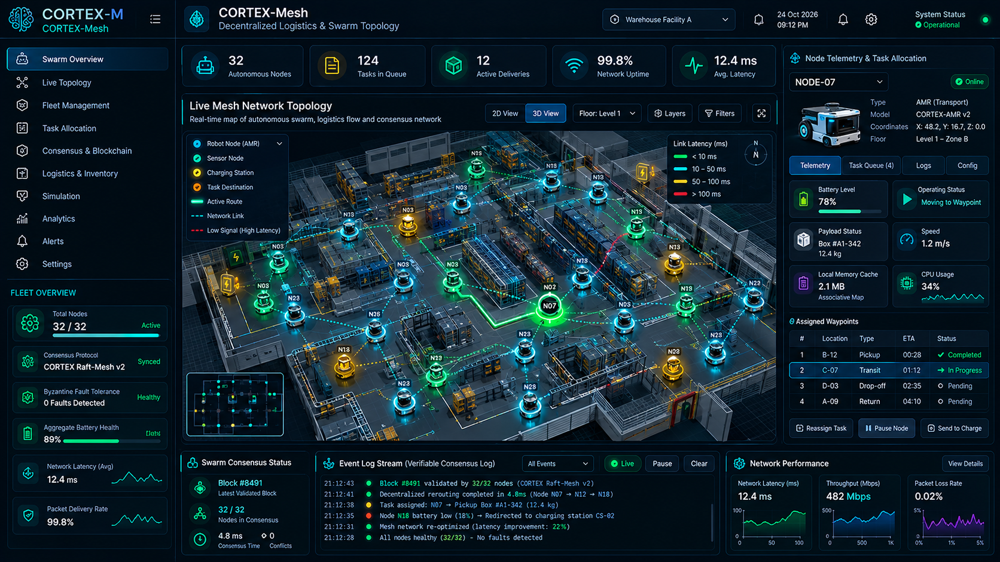

# CORTEX-Mesh: Autonomous Swarm & Logistics Command Center

  

## Overview
**CORTEX-Mesh** coordinates decentralized fleets of autonomous mobile robots, warehouse AGVs, and environmental sensor nodes. Focusing strictly on civilian logistics, facility mapping, and disaster search-and-rescue simulations, it enables multi-agent cooperative routing with transparent Byzantine Fault Tolerant (BFT) consensus.

---

## Key Capabilities
- **Geospatial Swarm Topology**: Live 2D/3D map displaying robot node coordinates, signal latency, and dynamic peer-to-peer routing edges.
- **Decentralized Consensus Stream**: Verifiable cryptographic logging of multi-node agreements with automatic failover during packet dropouts.
- **Node Health & Fleet Allocation**: Real-time tracking of battery reserves, associative cache states, and active payload queues.
- **Civilian Transparency**: Strict non-adversarial architecture ensuring all communications are verifiable, compliant, and auditable.
