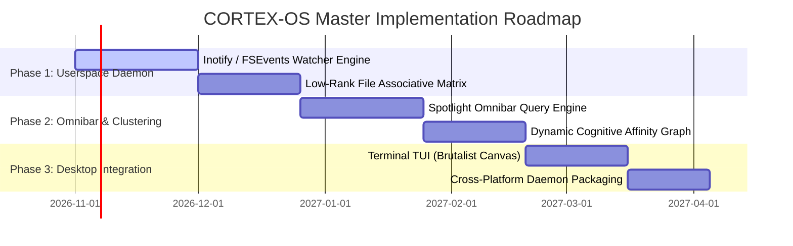

# CORTEX-OS: Master Product Requirements Document (PRD) & Software Requirements Specification (SRS)

**System Identifier:** `SYS-CORTEX-OS`  
**Document Revision:** `2.2.0-DETAILED`  
**Architectural Tier:** Userspace Cognitive Operating Environment & Associative Process Orchestrator  
**Execution Scope:** Non-Privileged Cross-Platform Userspace Service (Linux, macOS, Windows)  
**Design Identity:** Brutalist Graphite & Signal Orange (Carbon `#131313`, Graphite `#292B29`, Concrete `#777B73`, Signal Orange `#E56B46`, Acid Lime `#C5D75C`)  

---

# SECTION I: PRODUCT REQUIREMENTS DOCUMENT (PRD)

## 1. Executive Summary & Vision

### 1.1 Mission Statement
**CORTEX-OS** is an architectural research specification and userspace software environment for a next-generation cognitive operating system layer. Rather than forcing modern knowledge workers to organize their digital life strictly around hierarchical directory folder trees and brittle keyword filenames, CORTEX-OS continuously indexes files, terminal histories, documents, and research notes into **Dynamic Cognitive Affinity Clusters** powered by continuous attractor memory, while providing a zero-latency spotlight omnibar search.

### 1.2 Non-Privileged Userspace Sandbox Principle
* **Microkernel Preservation**: CORTEX-OS does not seek to replace or re-implement low-level operating system microkernels (Linux kernel, Darwin/XNU, Windows NT).
* **Strict Non-Privileged Execution**: The entire cognitive scheduler, file indexer, and omnibar engine runs under standard unprivileged user credentials (`UID != 0`). It possesses zero access to kernel ring 0 memory, raw disk blocks, or hardware interrupt vectors.
* **Respect for System Resources**: Operates as a dormant low-rank factor daemon consuming $\le 2.5\text{ MB}$ RAM when idle, waking up only upon file creation events or active user omnibar hotkey queries.

---

## 2. Market Problem Formulation & Flaw Analysis

| Dimension | Standard OS File Managers (Finder / Explorer) | Desktop Search Tools (Spotlight / Everything) | CORTEX-OS Solution |
|---|---|---|---|
| **Organization Model** | Rigid hierarchical tree; a file can only exist in one path unless manually symlinked. | Flat index; requires exact or wildcard filename matches; fails on conceptual search. | **Semantic Associative Clusters**: Documents automatically form dynamic affinity graphs based on active project context. |
| **Search Paradigm** | Slow recursive directory search; misses conceptual synonyms. | Fast lexical filename search, but zero understanding of document semantics or mathematical relationships. | **Continuous Attractor Omnibar**: Sub-millisecond conceptual retrieval; query *"spacecraft radiation mitigation"* surfaces un-named PDFs discussing SEU latchup. |
| **System Footprint** | Low footprint, but static and unhelpful. | High disk I/O; background indexers often grind laptop batteries and thrash SSDs. | **Low-Rank Paging Daemon**: Dormant footprint $\le 2.5\text{ MB}$ RAM; event-driven file hashing consuming $<2\%$ CPU. |
| **User Privacy** | Local, but increasingly coupled to cloud drive sync (OneDrive / iCloud). | Cloud search integration frequently sends search queries to commercial search engines. | **100% Local & Offline**: All semantic embeddings and associative matrices remain on local hardware with zero telemetry egress. |

---

## 3. User Personas & Use Cases

### 3.1 Personas
* **Cross-Disciplinary Researcher**: Juggles hundreds of academic papers, LaTeX drafts, and code scripts spanning multiple domains (e.g. Neuroscience, Control Theory, Distributed Systems).
* **Software Systems Architect**: Works across dozens of Git repositories; needs to recall where an elusive utility function was defined without opening 50 VS Code windows.
* **Privacy-Conscious Power User**: Desires a keyboard-driven, brutalist, distraction-free environment that prioritizes speed and cognitive flow.

### 3.2 End-to-End Operational Workflow

```
┌────────────────────────────────────────────────────────────────────────┐
│                   CORTEX-OS Userspace Architecture                     │
│                                                                        │
│   [Local Filesystem (ext4 / APFS / NTFS)]                              │
│                 │                                                      │
│                 ▼ (OS-Level File Event Notification: inotify / fsevents)│
│   [Non-Privileged Event Filter (Debounce: 500ms)]                      │
│                 │                                                      │
│                 ▼                                                      │
│   [Lightweight Text & AST Extractor (Extract Gist Vectors)]            │
│                 │                                                      │
│                 ▼                                                      │
│   [In-Memory Modern Hopfield Matrix W_os]                              │
│                 │                                                      │
│        ┌────────┴──────────────────────────┐                           │
│        ▼                                   ▼                           │
│   [Dynamic Affinity Clustering]     [Spotlight Omnibar Search]         │
│   Groups related projects into      Activated via Global Hotkey        │
│   associative working clusters      Sub-millisecond query evaluation   │
│   (e.g. Space-Sim + NASA-Docs)      Returns ranked conceptual matches  │
│        │                                   │                           │
│        └────────┬──────────────────────────┘                           │
│                 ▼                                                      │
│   [Brutalist Graphite & Signal Orange Terminal User Interface]         │
└────────────────────────────────────────────────────────────────────────┘
```

---

## 4. Master Implementation Roadmap



---

# SECTION II: SOFTWARE REQUIREMENTS SPECIFICATION (SRS)

## 1. Technical Stack & Dependencies

* **Core Runtime**: Python 3.12 / Rust Core Daemon (for zero-latency filesystem event filtering).
* **OS Event Interfaces**: Linux `inotify`, macOS `FSEvents` / `kqueue`, Windows `ReadDirectoryChangesW`.
* **Associative Index Engine**: Vectorized low-rank Modern Hopfield kernels ($d=64$, rank $r=4$).
* **IPC Transport**: Local Unix domain sockets (`/tmp/cortex_os.sock`) or Windows named pipes (`\\.\pipe\cortex_os`).
* **Terminal Interface**: ANSI / VT100 compliant terminal escape engine with truecolor support.

---

## 2. Mathematical & Clustering Formulations

### 2.1 File State Representation
Each monitored document $D_i$ is mapped into an invariant semantic state $\mathbf{d}_i \in \mathbb{R}^d$ ($d=64$) using the CORTEX-Gist factored bottleneck:
$$\mathbf{d}_i = \text{LayerNorm}\left(\mathbf{W}_{\text{proj}} \mathbf{z}_{\text{gist}}(D_i)\right)$$

### 2.2 Cognitive Affinity Graph Construction
The affinity weight $A_{ij} \in [0.0, 1.0]$ between document $D_i$ and document $D_j$ is determined by their mutual attractor energy resonance:
$$A_{ij} = \exp\left(-\frac{\|\mathbf{d}_i - \mathbf{d}_j\|^2_2}{2 \sigma_{\text{affinity}}^2}\right)$$
Documents with $A_{ij} \ge \theta_{\text{cluster}}$ form an edge in the Dynamic Cognitive Affinity Graph $\mathcal{G} = (\mathcal{V}, \mathcal{E})$. Connected components in $\mathcal{G}$ define active cognitive project clusters that update dynamically as files are edited.

---

## 3. Detailed Functional Requirements (FRs)

### FR-OS-01: Non-Privileged Filesystem Event Watcher
* **Requirement ID**: `FR-OS-01`
* **Input**: User-configured watch paths (e.g. `~/Projects`, `~/Documents`).
* **Processing**:
  1. Register native OS event listeners on directories.
  2. Filter file extensions (`.py`, `.md`, `.rs`, `.tex`, `.pdf`, `.txt`).
  3. Apply 500ms debounce filter to eliminate partial-write thrashing during IDE saves.
  4. Extract text content without blocking filesystem I/O.
* **Output**: `FileModifiedEvent` emitted to internal event queue.

### FR-OS-02: Spotlight Associative Omnibar
* **Requirement ID**: `FR-OS-02`
* **Input**: User conceptual query string from omnibar prompt.
* **Processing**:
  1. Encode query into 64-D vector $\mathbf{q}$.
  2. Compute parallel dot-product against all stored document vectors: $\mathbf{s} = \mathbf{D} \mathbf{q}$.
  3. Perform continuous Hopfield attractor relaxation (3 iterations).
  4. Sort documents by descending converged resonance score.
* **Output**: Top-$k$ ranked documents with file path, line preview, and affinity score.

### FR-OS-03: Dynamic Cognitive Affinity Graph Emission
* **Requirement ID**: `FR-OS-03`
* **Input**: Active document identifiers open in user workspace.
* **Processing**:
  1. Extract connected components from affinity graph $\mathcal{G}$.
  2. Assign human-readable cluster label derived from dominant semantic head.
  3. Format cluster tree for terminal status bar.
* **Output**: `AffinityClusterReport` listing related project files.

---

## 4. Non-Functional Software Requirements (NFSRs)

### NFSR-OS-01: Resource & Idle Memory Ceilings
* Idle resident memory: strictly $\le 2.5\text{ MB}$ RAM.
* Background CPU utilization: capped at $\le 2.0\%$ of a single logical core during active indexing.

### NFSR-OS-02: Omnibar Latency Budget
* Query evaluation latency: $\le 1.0\text{ ms}$ for candidate pools of up to $50,000$ documents.
* Hotkey activation to omnibar display latency: $\le 15.0\text{ ms}$.

### NFSR-OS-03: Visual Identity & Design System Integration
* Complies with **Brutalist Graphite & Signal Orange**:
  - Carbon (`#131313`): Deep brutalist canvas background (70%).
  - Graphite (`#292B29`): Window borders and dock split panes (20%).
  - Concrete (`#777B73`): File metadata, path labels, and timestamps (10%).
  - Signal Orange (`#E56B46`): **Signature Accent** — Omnibar cursor, search focus, and active cluster indicator (5% Focal).
  - Acid Lime (`#C5D75C`): Live filesystem event pulses and indexing activity pings.
