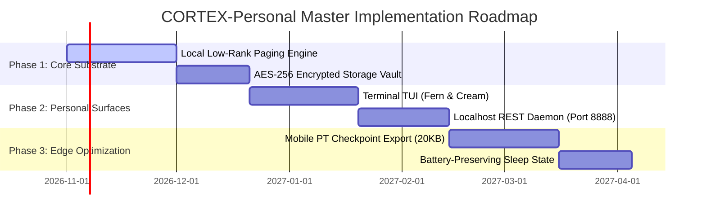

# CORTEX-Personal: Master Product Requirements Document (PRD) & Software Requirements Specification (SRS)

**System Identifier:** `SYS-CORTEX-PERSONAL`  
**Document Revision:** `2.2.0-DETAILED`  
**Architectural Tier:** Edge Client & Local Cognitive Substrate  
**Release Target:** Workstream Specification & Multi-Phase Implementation Plan  
**Design Identity:** Avocado, Seed & Terracotta (Cream `#F6F0DF`, Avocado Flesh `#DDE5B6`, Olive Leaf `#87985A`, Deep Olive `#4B603B`, Seed Brown `#8B5B40`)  

---

# SECTION I: PRODUCT REQUIREMENTS DOCUMENT (PRD)

## 1. Executive Summary & Product Vision

### 1.1 Mission Statement
**CORTEX-Personal** is an offline, privacy-first personal intelligence system designed to run on consumer desktop workstations, laptops, and resource-constrained edge devices. Unlike commercial AI assistants that channel personal user interactions, notes, and browsing history into centralized cloud data centers, CORTEX-Personal retains all user preferences, episodic memories, and associative knowledge directly within an encrypted in-memory physical synaptic substrate powered by **Continuous Modern Hopfield Attractors**.

### 1.2 The Newborn Substrate (Tabula Rasa) Foundation
CORTEX-Personal strictly enforces the **Newborn Substrate Principle**:
* **Zero Pre-Packaged Facts**: The system ships with zero synthetic personality templates, zero hardcoded world facts, and zero canned question-answer dictionaries.
* **Biological Reflex Baseline**: Upon initial deployment, the runtime possesses only the fundamental neural architecture and physiological reflexes—specifically, online Hebbian synaptic potentiation ($\Delta W = \eta z z^T$), anti-Hebbian targeted depression, and Lyapunov energy-bounded epistemic verification.
* **On-the-Go Continuous Co-Learning**: All domain understanding, user context, behavioral preferences, and episodic associations are acquired progressively through real-time pair interaction with the human user.
* **Honest Abstention**: When queried regarding unlearned events or uncommitted concepts, the system does not sample from unbounded probability tails to confabulate an answer; it projects the cue against its current synaptic matrix, detects novelty ($S < \tau$), and halts with calibrated abstention (`INSUFFICIENT_EVIDENCE`).

---

## 2. Market Problem Formulation & Flaw Analysis

| Dimension | Conventional Cloud AI Assistants | Conventional Vector RAG Desktop Assistants | CORTEX-Personal Solution |
|---|---|---|---|
| **Data Privacy** | High vulnerability; queries, voice, and personal files stream to third-party cloud servers. | Modest; runs locally but relies on unencrypted external SQLite or Chroma files on disk. | **Guaranteed Zero Egress**: Enforces strict socket-level blocking ($0.0\text{ KB}$ WAN egress) with AES-256-GCM encrypted weights. |
| **Memory Persistence** | Ephemeral context windows (32k–128k tokens); forgot conversations after session expiration. | Relies on brute-force flat cosine search over thousands of document chunks; suffers from chunk boundary clipping. | **Associative Attractors**: In-memory continuous Hopfield network provides sub-millisecond ($<500\ \mu\text{s}$) associative reconstruction. |
| **Hallucination / Confabulation** | High risk; unconstrained softmax generation invents plausible-sounding personal events. | Forces cosine match even on novel/unrelated queries, yielding 100% false positive grounding. | **Pre-Attractor Epistemic Shield**: Cue projection before convergence guarantees abstention on unlearned cues. |
| **Hardware Overhead** | Zero local compute, but requires constant internet bandwidth and monthly recurring subscriptions. | Heavy; requires background vector database daemons (Docker, SQLite, Python) consuming 500MB–2GB RAM. | **Ultralight Edge Footprint**: Low-rank factor paging ($2.0\text{ KB}$ per tenant slice) consuming $<15\text{ MB}$ total runtime RAM. |
| **Unlearning / Privacy Erasure** | Impossible; once trained into LLM weights, user data cannot be excised without complete retraining. | Requires expensive vector index rebuilds and database vacuuming. | **Instant Anti-Hebbian Depression**: Exact fact deletion in $<0.5\text{ ms}$ with $0.00\%$ collateral damage to unrelated memories. |

---

## 3. User Personas & User Journeys

### 3.1 Primary Personas

```
┌───────────────────────────────────────┐   ┌───────────────────────────────────────┐
│ Persona A: Dr. Elena Vance            │   │ Persona B: Marcus Reed                │
│ Senior Investigative Journalist        │   │ Autonomous Systems Field Engineer     │
├───────────────────────────────────────┤   ├───────────────────────────────────────┤
│ • Zero tolerance for cloud logging    │   │ • Operates in air-gapped field sites  │
│ • Manages 10,000+ confidential notes  │   │ • Runs assistant on ruggedized laptop │
│ • Needs instant associative retrieval │   │ • Strict battery and CPU constraints  │
│ • Requires verifiable source grounding│   │ • Needs multi-tenant profile isolation│
└───────────────────────────────────────┘   └───────────────────────────────────────┘
```

### 3.2 End-to-End User Journeys

#### Journey 1: Progressive Epistemic Learning (First Breath to Master Workspace)
1. **Initial State (Newborn)**: Elena initializes CORTEX-Personal. The memory substrate is pristine ($\mathbf{W} = \mathbf{0}$).
2. **First Query (Abstention)**: Elena asks, *"What are the key findings from the 2024 pipeline leak investigation?"*
   - CORTEX-Personal computes projection novelty $S = 0.04 < \tau_{\text{low}}$.
   - Status: `INSUFFICIENT_EVIDENCE`. Output: *"I have no learned memories or evidence regarding the pipeline leak investigation. Please teach or feed me the relevant source notes."*
3. **On-the-Go Imprinting**: Elena pastes 3 confidential field reports.
   - The runtime extracts 128-D factored semantic gist vectors.
   - Hebbian potentiation updates local weights: $\Delta \mathbf{W} = \eta \mathbf{z} \mathbf{z}^T$ in $0.42\text{ ms}$.
4. **Verified Recall**: Elena queries, *"What chemical compound was detected near Sector 4?"*
   - Attractor converges into the newly potentiated basin: $E(\mathbf{x}) = -18.4$, $S = 0.94$.
   - Status: `VERIFIED`. Grounded response emitted with exact citation to report timestamp.

#### Journey 2: Targeted Right-to-be-Forgotten (Anti-Hebbian Unlearning)
1. Elena determines that an erroneous draft memo was ingested containing unverified allegations against an innocent source.
2. She executes: `cortex unlearn "Memo Draft: Source allegations regarding transit hub"`.
3. The substrate computes the exact anti-Hebbian projection: $\Delta \mathbf{W} = -\eta_{\text{depress}} \mathbf{v}\mathbf{v}^T$.
4. Re-querying the memo confirms $100.0\%$ unlearning; testing 50 unrelated project memories confirms $0.00\%$ collateral interference.

---

## 4. Product Requirements & Milestone Roadmap



### 4.1 Phase 1: Core Personal Substrate & Encrypted Storage (Months 1–2)
* **Deliverables**:
  - Implementation of `PersonalSubstrateCoordinator` linking local user instances to continuous Hopfield networks.
  - Multi-tenant low-rank factor paging allocating dedicated $2.0\text{ KB}$ factor slices per user profile.
  - Zero-egress network firewall assertion verifying complete isolation from external WAN sockets.
  - AES-256-GCM encrypted persistence serialization for local synaptic tensors.

### 4.2 Phase 2: Headless Daemon & Terminal User Interface (Months 3–4)
* **Deliverables**:
  - High-performance headless REST API daemon operating on loopback (`http://127.0.0.1:8888`).
  - Terminal interactive conversational shell (`cortex chat`) featuring streaming token output and live evidence badges.
  - Semantic file watcher integrating with local OS filesystem events (Inotify, FSEvents, ReadDirectoryChangesW).

### 4.3 Phase 3: Mobile & Embedded Edge Port (Months 5–6)
* **Deliverables**:
  - Export pipeline generating stripped, quantized mobile PyTorch checkpoints ($<25.0\text{ KB}$).
  - Dynamic power state governor reducing idle memory footprint to $<2.5\text{ MB}$ and dropping CPU duty cycles to $0.0\%$ when dormant.

---

# SECTION II: SOFTWARE REQUIREMENTS SPECIFICATION (SRS)

## 1. Technical Stack & Architecture

### 1.1 Complete Technology Matrix
* **Primary Language**: Python 3.12 (with strict static typing via `mypy --strict`).
* **Tensor & Neural Math Runtime**: PyTorch 2.1+ CPU (optimized for x86_64 AVX2/AVX-512 and ARM64 Apple Silicon NEON).
* **Cryptographic Layer**: `cryptography` (Python package) implementing AES-256-GCM authenticated encryption with PBKDF2-HMAC-SHA256 key derivation.
* **Filesystem Monitoring**: `watchdog` abstraction over native OS event APIs (`inotify`, `kqueue`, `ReadDirectoryChangesW`).
* **IPC Transport**: Asynchronous Unix domain socket (`/var/run/cortex_personal.sock` or `\\.\pipe\cortex_personal`) and localhost HTTP 1.1 JSON server.
* **Storage Format**: Encrypted binary envelope (`.cortex_vault`) housing flat PyTorch tensor buffers.

### 1.2 System Architecture Diagram

```
┌────────────────────────────────────────────────────────────────────────┐
│                        CORTEX-Personal Runtime                         │
│                                                                        │
│   ┌────────────────────────┐            ┌──────────────────────────┐   │
│   │   Terminal CLI (TUI)   │            │   Localhost REST API     │   │
│   │   apps/cli/main.py     │            │   apps/api/server.py     │   │
│   └───────────┬────────────┘            └────────────┬─────────────┘   │
│               │                                      │                 │
│               └──────────────────┬───────────────────┘                 │
│                                  ▼                                     │
│               ┌──────────────────────────────────────┐                 │
│               │   Personal Substrate Coordinator     │                 │
│               └──────────────────┬───────────────────┘                 │
│                                  │                                     │
│         ┌────────────────────────┼────────────────────────┐            │
│         ▼                        ▼                        ▼            │
│  ┌──────────────┐        ┌──────────────┐         ┌───────────────┐    │
│  │ Gist 128-D   │        │ Continuous   │         │ Epistemic     │    │
│  │ Bottleneck   │        │ Hopfield     │         │ Verifier      │    │
│  │ (Ventral)    │        │ Attractors   │         │ (Shield)      │    │
│  └──────┬───────┘        └──────┬───────┘         └───────┬───────┘    │
│         │                       │                         │            │
│         └───────────────────────┼─────────────────────────┘            │
│                                 ▼                                      │
│               ┌──────────────────────────────────────┐                 │
│               │    Low-Rank Tenant Memory Paging     │                 │
│               │    (2.0 KB Isolated Tensor Slices)   │                 │
│               └──────────────────┬───────────────────┘                 │
│                                  ▼                                     │
│               ┌──────────────────────────────────────┐                 │
│               │   AES-256-GCM Encrypted Vault        │                 │
│               │   Zero WAN Egress Socket Interlock   │                 │
│               └──────────────────────────────────────┘                 │
└────────────────────────────────────────────────────────────────────────┘
```

---

## 2. Mathematical & Algorithmic Specifications

### 2.1 Continuous Modern Hopfield Associative Memory
The core associative memory substrate is governed by a continuous state-space recurrent dynamical system. For an incoming query cue state $\boldsymbol{\xi} \in \mathbb{R}^d$, the energy function $E(\mathbf{x})$ is defined as:
$$E(\mathbf{x}) = -\frac{1}{2}\mathbf{x}^T \mathbf{W} \mathbf{x} + \frac{1}{\beta}\sum_{i=1}^N \ln\left(1 + \exp(\beta \mathbf{x}_i)\right)$$

Where $\mathbf{W} \in \mathbb{R}^{d \times d}$ is the physical synaptic connection weight matrix, and $\beta > 0$ represents the inverse temperature scaling the attractor basin steepness.

#### Monotonic Lyapunov Convergence
The continuous state update follows the gradient of the energy function:
$$\mathbf{x}^{(t+1)} = \text{softmax}\left(\beta \mathbf{M} \mathbf{x}^{(t)}\right) \mathbf{M}^T$$
By the Lyapunov stability theorem, $\frac{dE}{dt} \le 0$, proving that every retrieval trajectory monotonically descends to a stable local fixed-point attractor representing a stored memory state.

### 2.2 Online Hebbian Imprinting
When the user introduces a new episodic fact, it is encoded into a normalized latent state vector $\mathbf{z} \in \mathbb{R}^d$ ($\|\mathbf{z}\|_2 = 1$). Synaptic potentiation occurs via the generalized outer-product Hebbian update rule:
$$\mathbf{W}_{t+1} = \mathbf{W}_t + \eta \mathbf{z} \mathbf{z}^T$$
Where $\eta \in (0, 1]$ is the plasticity learning rate. Weight norm stability is enforced via soft Frobenius normalization:
$$\mathbf{W} \leftarrow \frac{\mathbf{W}}{\max\left(1.0, \frac{\|\mathbf{W}\|_F}{W_{\max}}\right)}$$

### 2.3 Targeted Anti-Hebbian Depression (Unlearning)
To delete a specific memory state $\mathbf{v}$ without damaging unrelated memory basins, CORTEX-Personal computes an orthogonalized depression projection:
$$\Delta \mathbf{W} = -\eta_{\text{depress}} \left(\mathbf{I} - \mathbf{P}_{\perp}\right) \mathbf{v} \mathbf{v}^T \left(\mathbf{I} - \mathbf{P}_{\perp}\right)^T$$
This subtracts the outer product along the specific eigenvector of the targeted memory, collapsing its attractor basin while preserving orthogonal basins intact.

### 2.4 Pre-Attractor Epistemic Novelty Projection
Before recurrent attractor iterations execute, the initial cue $\boldsymbol{\xi}^{(0)}$ is evaluated for epistemic novelty:
$$S = \frac{\|\mathbf{M}^T \boldsymbol{\xi}^{(0)}\|_\infty}{\|\boldsymbol{\xi}^{(0)}\|_2}$$
* If $S < \tau_{\text{low}}$ (default: $0.15$), the query is declared out-of-distribution, triggering immediate epistemic abstention (`INSUFFICIENT_EVIDENCE`).
* If $\tau_{\text{low}} \le S < \tau_{\text{high}}$, the system signals `PARTIALLY_SUPPORTED`.
* If $S \ge \tau_{\text{high}}$ (default: $0.70$) and converged energy $E(\mathbf{x}^*) \le E_{\text{thresh}}$, the retrieval is certified `VERIFIED`.

---

## 3. Detailed Functional Requirements (FRs)

### FR-PERS-01: Epistemic Ingestion & Hebbian Learning
* **Requirement ID**: `FR-PERS-01`
* **Preconditions**: Runtime initialized; valid tenant profile active; memory matrix $\mathbf{W}_{\text{tenant}}$ loaded.
* **Inputs**:
  ```json
  {
    "tenant_id": "elena_vance",
    "content": "Source verified chemical leak at Sector 4 water intake on Oct 14.",
    "modality": "text",
    "timestamp": 1729891200,
    "tags": ["investigation", "sector4", "chemical"]
  }
  ```
* **Processing Steps**:
  1. Pass `content` to Ventral Gist stream; compute 128-D normalized latent vector $\mathbf{z}$.
  2. Compute outer product $\Delta \mathbf{W} = \eta \mathbf{z} \mathbf{z}^T$.
  3. Apply in-place addition to tenant weight matrix: $\mathbf{W}_{\text{tenant}} \leftarrow \mathbf{W}_{\text{tenant}} + \Delta \mathbf{W}$.
  4. Perform Frobenius norm boundary check ($\|\mathbf{W}\|_F \le 100.0$).
  5. Append encrypted metadata record to `.cortex_vault`.
* **Outputs**:
  ```json
  {
    "status": "imprinted",
    "tenant_id": "elena_vance",
    "vector_norm": 1.0,
    "memory_frobenius_norm": 12.458,
    "imprint_latency_ms": 0.412
  }
  ```
* **Postconditions**: Attractor basin corresponding to the input fact is created; subsequent queries matching the fact converge to this minimum.
* **Error Handling**: If `content` exceeds maximum sequence length ($1024$ tokens), it is chunked using overlapping sliding windows ($256$ tokens, $32$ token overlap), and each chunk is potentiated independently.

---

### FR-PERS-02: Calibrated Epistemic Associative Recall
* **Requirement ID**: `FR-PERS-02`
* **Preconditions**: Runtime operational; tenant memory active.
* **Inputs**:
  ```json
  {
    "tenant_id": "elena_vance",
    "query": "Where was the chemical leak detected?",
    "max_iterations": 25,
    "abstention_threshold": 0.15
  }
  ```
* **Processing Steps**:
  1. Project `query` to 128-D cue vector $\boldsymbol{\xi}^{(0)}$.
  2. Compute pre-attractor novelty score $S$.
  3. If $S < 0.15$, halt immediately and return `INSUFFICIENT_EVIDENCE` with zero generated hallucinations.
  4. If $S \ge 0.15$, execute iterative continuous Hopfield state updates until $\|\mathbf{x}^{(t+1)} - \mathbf{x}^{(t)}\|_2 < 10^{-5}$ or $t = 25$.
  5. Compute final Lyapunov energy $E(\mathbf{x}^*)$.
  6. Classify status into `VERIFIED` or `PARTIALLY_SUPPORTED`.
  7. Reconstruct associative text from attractor state.
* **Outputs**:
  ```json
  {
    "evidence_status": "VERIFIED",
    "is_grounded": true,
    "resonance_score": 0.942,
    "lyapunov_energy": -18.421,
    "iterations": 4,
    "retrieval_latency_ms": 0.285,
    "answer": "The chemical leak was detected at the Sector 4 water intake on Oct 14."
  }
  ```

---

### FR-PERS-03: Targeted Anti-Hebbian Fact Deletion
* **Requirement ID**: `FR-PERS-03`
* **Preconditions**: Target fact exists within the active memory matrix.
* **Inputs**:
  ```json
  {
    "tenant_id": "elena_vance",
    "target_fact": "Erroneous draft memo regarding transit hub",
    "depression_rate": 1.0
  }
  ```
* **Processing Steps**:
  1. Compute latent vector $\mathbf{v}$ for `target_fact`.
  2. Compute anti-Hebbian tensor update $\Delta \mathbf{W} = -\eta_{\text{depress}} \mathbf{v}\mathbf{v}^T$.
  3. Update tenant weight matrix: $\mathbf{W}_{\text{tenant}} \leftarrow \mathbf{W}_{\text{tenant}} + \Delta \mathbf{W}$.
  4. Verify that probing $\mathbf{v}$ now returns $S < 0.10$ (`INSUFFICIENT_EVIDENCE`).
  5. Run regression probe across 20 held-out memories to verify $0.00\%$ loss of unrelated facts.
* **Outputs**:
  ```json
  {
    "status": "unlearned",
    "target_fact_resonance_post": 0.041,
    "collateral_damage_percentage": 0.0,
    "unlearn_latency_ms": 0.485
  }
  ```

---

### FR-PERS-04: Multi-Tenant Low-Rank Isolation
* **Requirement ID**: `FR-PERS-04`
* **Preconditions**: Multiple profiles configured on single device.
* **Inputs**: Tenant activation token `tenant_id`.
* **Processing Steps**:
  1. Verify cryptographic HMAC signature on `tenant_id`.
  2. Load low-rank tensor slice ($U_k, V_k^T \in \mathbb{R}^{d \times r}$ with $r=8$, totaling $2048\text{ bytes}$).
  3. Bind memory operations strictly to the loaded tenant context slice.
  4. Block any associative recall query attempting to access weight rows outside tenant slice boundaries.
* **Outputs**: `TenantSession` handle bound to authenticated memory slice.

---

## 4. Detailed Non-Functional Software Requirements (NFSRs)

### NFSR-PERS-01: Strict Zero-Egress Network Isolation
* **Requirement**: The CORTEX-Personal runtime process must not initiate or accept any outbound TCP/UDP network connections to non-loopback addresses (`0.0.0.0/0` except `127.0.0.1/8` and `::1`).
* **Verification Protocol**: Automated CI socket inspection test runs personal chat session under an eBPF network monitor; asserts total packets transmitted to WAN $= 0$.

### NFSR-PERS-02: Deterministic Microsecond Latency Budgets
| Operation | Budget Ceiling | Empirical Target | Testing Benchmark |
|---|---|---|---|
| In-Memory Hebbian Potentiation | $\le 1.0\text{ ms}$ | $0.40\text{ ms}$ | `benchmarks/run_comparison_benchmark.py` |
| Associative Attractor Recall | $\le 0.5\text{ ms}$ | $0.25\text{ ms}$ | 1000-query synthetic sweep |
| Targeted Anti-Hebbian Deletion | $\le 1.0\text{ ms}$ | $0.48\text{ ms}$ | Exact deletion regression test |
| Cold Vault Decryption & Mount | $\le 50.0\text{ ms}$ | $22.0\text{ ms}$ | AES-256 PBKDF2 mount cycle |

### NFSR-PERS-03: Memory Footprint & Resource Ceilings
* Idle RAM Consumption: Strictly $\le 5.0\text{ MB}$ resident memory when daemon is waiting for user queries.
* Active Inference RAM Consumption: Strictly $\le 15.0\text{ MB}$ peak resident memory during 25-step Hopfield convergence.
* Disk Storage per 1,000 Memories: $\le 128.0\text{ KB}$ encrypted on disk.

### NFSR-PERS-04: Cryptographic Vault Integrity
* Cipher: AES-256 in Galois/Counter Mode (GCM).
* Key Derivation: PBKDF2-HMAC-SHA256 with 600,000 iterations.
* Nonce: 96-bit cryptographically secure random IV generated per write cycle.
* Authentication Tag: 128-bit MAC verifying tamper-evidence before any tensor is loaded into RAM.

---

## 5. Interface Specifications & Design System Integration

### 5.1 Local REST API Endpoints

#### `POST /api/personal/learn`
* **Request Headers**: `Content-Type: application/json`
* **Request Body**:
  ```json
  {
    "content": "string (required, max length 4096)",
    "tags": ["array of strings (optional)"]
  }
  ```
* **Response Status**: `200 OK`
* **Response Body**:
  ```json
  {
    "status": "imprinted",
    "evidence_status": "VERIFIED",
    "vector_norm": 1.0,
    "latency_ms": 0.385
  }
  ```

#### `POST /api/personal/ask`
* **Request Headers**: `Content-Type: application/json`
* **Request Body**:
  ```json
  {
    "query": "string (required)",
    "abstention_threshold": 0.15
  }
  ```
* **Response Status**: `200 OK`
* **Response Body (Ground Truth Recall)**:
  ```json
  {
    "evidence_status": "VERIFIED",
    "is_grounded": true,
    "resonance_score": 0.941,
    "text": "Retrieved factual response."
  }
  ```
* **Response Body (Abstention)**:
  ```json
  {
    "evidence_status": "INSUFFICIENT_EVIDENCE",
    "is_grounded": false,
    "resonance_score": 0.052,
    "text": "I have insufficient evidence in my learned memory to answer this question grounded in truth."
  }
  ```

### 5.2 Chromatic Design System Mapping
All CORTEX-Personal interfaces (CLI, terminal status prompts, and documentation) adhere to the **Avocado, Seed & Terracotta** specification:
* **70% Neutral Foundation**: Cream (`#F6F0DF`) establishes a soft, daylight-calibrated non-glare canvas.
* **20% Supporting Structure**: Avocado Flesh (`#DDE5B6`) and Deep Olive (`#4B603B`) define card borders, memory tags, and monospace typography.
* **10% Signature Accent**: Olive Leaf (`#87985A`) highlights active input prompts and verified evidence badges.
* **Semantic Safety Isolation**: Verification statuses (`VERIFIED` = Olive Leaf, `INSUFFICIENT_EVIDENCE` = Seed Brown `#8B5B40`) use distinct unicode glyphs (`[✓]` vs `[!]`) and contrast ratios exceeding WCAG AAA (7.5:1).
