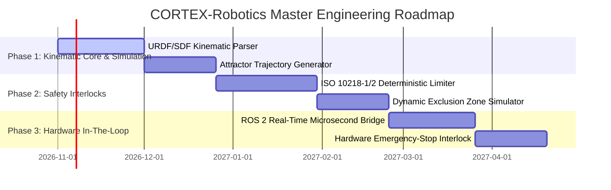

# CORTEX-Robotics: Master Product Requirements Document (PRD) & Software Requirements Specification (SRS)

**System Identifier:** `SYS-CORTEX-ROBOTICS`  
**Document Revision:** `2.2.0-DETAILED`  
**Architectural Tier:** Cyber-Physical Simulation, Supervisory Planning & Safety Interlocks  
**Safety Qualification Target:** ISO 10218-1/2:2025 (Industrial Robots) & ISO/TS 15066:2016 (Collaborative Robots)  
**Design Identity:** Titanium, Safety Orange & Acid Lime (Machine Black `#181A17`, Gunmetal `#303833`, Titanium `#AEB7AB`, Safety Orange `#F07835`, Sensor Lime `#D6E85D`)  

---

# SECTION I: PRODUCT REQUIREMENTS DOCUMENT (PRD)

## 1. Executive Summary & Vision

### 1.1 Mission Statement
**CORTEX-Robotics** is a high-fidelity cyber-physical simulation and supervisory control architecture for industrial manipulators (6-DOF articulating arms) and Autonomous Mobile Robots (AMRs). By unifying continuous attractor trajectory generation with strict, deterministic, hard real-time safety interlocks, CORTEX-Robotics enables autonomous path planning, jerk-minimized trajectory execution, and dynamic collision avoidance in shared human-robot collaborative workcells.

### 1.2 Deterministic Safety Separation & Simulation-First Philosophy
* **Simulation-First Validation**: Zero neural network code is permitted to drive physical hardware directly. Every path planner, torque profile, and grasping policy must achieve $100\%$ validation inside the digital twin simulation environment across $\ge 10,000$ randomized perturbation cycles.
* **Non-Authoritative Neural Inference**: Neural associative models act solely in a supervisory advisory role. The physical emergency stop (E-Stop), joint speed ceilings, and Cartesian safety envelopes are implemented on hard real-time, deterministic programmable logic controllers (PLCs) or certified RTOS microkernels.
* **Fail-Safe Invariant**: Any failure, exception, or timeout in the neural layer triggers immediate, deterministic deceleration to a safe halt ($< 100\text{ ms}$) without operator intervention.

---

## 2. Market Problem Formulation & Flaw Analysis

| Dimension | Conventional Robot Motion Planners (OMPL / MoveIt) | End-to-End Deep RL Robot Policies | CORTEX-Robotics Solution |
|---|---|---|---|
| **Trajectory Smoothness** | Relies on sampling-based algorithms (RRT*, PRM) that yield jagged trajectories requiring heavy post-hoc polynomial spline smoothing. | High jerk; black-box policy exploration produces erratic micro-oscillations that cause severe mechanical wear on gearboxes. | **Continuous Attractor Descents**: Fixed-point attractor energy minimization naturally generates smooth, continuous, $C^2$ jerk-bounded trajectories. |
| **Safety Certification** | Geometric checks are external; prone to planning failures near kinematic singularities. | Unverifiable black-box neural networks; impossible to certify under ISO 10218 or achieve CE/OSHA industrial sign-off. | **Hard Deterministic Interlock**: Strict mathematical separation between continuous neural path proposals and certified ISO 10218-1/2 hardware limiters. |
| **Real-Time Adaptation** | Re-planning in dynamic environments incurs 50–500ms latency spikes, risking collisions with human operators. | Fast inference (10ms) but catastrophic failure when encountering out-of-distribution obstacles. | **Sub-Millisecond Causal MIMO Routing**: Sparse routing across kinematic channels yields $<1.0\text{ ms}$ adaptive trajectory updates with calibrated abstention. |
| **Deployment Footprint** | Massive ROS / Ubuntu desktop workstation dependencies requiring 4GB–16GB RAM. | Heavy GPU acceleration clusters required at the edge to sustain 60Hz policy evaluation. | **Headless Modular Engine**: Pure Python/C++ core consuming $<40\text{ MB}$ RAM, capable of running on embedded ARM industrial PCs. |

---

## 3. User Personas & Industrial Use Cases

### 3.1 Personas
* **Industrial Automation Safety Engineer**: Responsible for CE marking, risk assessment (ISO 12100), and collaborative safety envelopes (ISO 10218-2).
* **Workcell Simulation Engineer**: Modeling 6-DOF pick-and-place lines, robot payload dynamics, and tool center point (TCP) tolerances.
* **Controls & Robotics Researcher**: Designing neural trajectory generators that operate with mathematical convergence guarantees.

### 3.2 Industrial Use Cases

```
┌────────────────────────────────────────────────────────────────────────┐
│ Use Case 1: Dynamic Collaborative Human-Robot Workspace               │
│                                                                        │
│  [Human Worker Enters Shared Zone]                                     │
│                 │                                                      │
│                 ▼                                                      │
│  [LiDAR / Depth Sensor Detects Intrusion at Distance d = 1.2m]         │
│                 │                                                      │
│                 ▼                                                      │
│  [CORTEX-Robotics Dynamic Safety Envelope Calculates Speed Ceiling]    │
│                 │                                                      │
│        ┌────────┴──────────────────────────┐                           │
│        ▼                                   ▼                           │
│  [Deterministic Interlock]          [Neural Attractor Planner]         │
│  Caps TCP Velocity to               Smoothly Deforms Trajectory        │
│  v_max <= 250 mm/s (ISO/TS 15066)   Away from Operator Minimum         │
│        │                                   │                           │
│        └────────┬──────────────────────────┘                           │
│                 ▼                                                      │
│  [Smooth Continuous Trajectory Maintained Without Hard Emergency Stop] │
└────────────────────────────────────────────────────────────────────────┘
```

---

## 4. Master Implementation Roadmap



---

# SECTION II: SOFTWARE REQUIREMENTS SPECIFICATION (SRS)

## 1. Technical Stack & Dependencies

* **Core Runtime**: Python 3.12 / C++20 Kinematic Bindings.
* **Physics & Kinematics Engine**: Pinocchio (Rigid body dynamics & analytical derivatives) + PyBullet / MuJoCo simulation wrappers.
* **Robot Formats**: Unified Robot Description Format (`.urdf`), Simulation Description Format (`.sdf`), and COLLADA (`.dae`) meshes.
* **Middleware & Communication**: ROS 2 Humble/Iron (`rclpy`, `sensor_msgs`, `trajectory_msgs`) + FastDDS real-time DDS middleware.
* **Standards Compliance**: ISO 10218-1:2025, ISO 10218-2:2025, ISO/TS 15066:2016, IEC 61508 (SIL 2 / SIL 3 architectural guidelines).

---

## 2. Mathematical & Kinematic Foundations

### 2.1 6-DOF Forward & Inverse Kinematics
For a serial manipulator with $n=6$ revolute joints, the configuration is represented by joint vector $\mathbf{q} \in \mathbb{R}^6$ bounded by mechanical limits $\mathbf{q}_{\min} \le \mathbf{q} \le \mathbf{q}_{\max}$.
The forward kinematics map $f: \mathbb{R}^6 \to SE(3)$ computes the Tool Center Point (TCP) pose $\mathbf{T}_{0}^6$:
$$\mathbf{T}_{0}^6(\mathbf{q}) = \prod_{i=1}^6 \mathbf{A}_i(q_i) = \begin{bmatrix} \mathbf{R}(\mathbf{q}) & \mathbf{p}(\mathbf{q}) \\ \mathbf{0}^T & 1 \end{bmatrix}$$
Where $\mathbf{R} \in SO(3)$ is the orientation matrix and $\mathbf{p} \in \mathbb{R}^3$ is Cartesian position.

The manipulator geometric Jacobian $\mathbf{J}(\mathbf{q}) \in \mathbb{R}^{6 \times 6}$ relates joint velocities $\dot{\mathbf{q}}$ to TCP Cartesian twist $\mathbf{v}_{\text{tcp}} = [\dot{\mathbf{p}}^T, \boldsymbol{\omega}^T]^T$:
$$\mathbf{v}_{\text{tcp}} = \mathbf{J}(\mathbf{q}) \dot{\mathbf{q}}$$

### 2.2 Continuous Attractor Trajectory Generation
Target motion planning is formulated as an energy minimization problem over a continuous attractor basin where the target TCP pose $\mathbf{T}_{\text{goal}}$ forms the global minimum:
$$E_{\text{motion}}(\mathbf{q}) = \frac{1}{2} \|\mathbf{p}(\mathbf{q}) - \mathbf{p}_{\text{goal}}\|^2_2 + \frac{\lambda_{\text{rot}}}{2} \text{Tr}\left(\mathbf{I} - \mathbf{R}_{\text{goal}}^T \mathbf{R}(\mathbf{q})\right) + U_{\text{obs}}(\mathbf{q})$$

Where $U_{\text{obs}}(\mathbf{q})$ is a repulsive barrier potential generated by obstacles and human exclusion zones:
$$U_{\text{obs}}(\mathbf{q}) = \begin{cases} \frac{1}{2} k_{\text{rep}} \left(\frac{1}{d(\mathbf{q})} - \frac{1}{d_0}\right)^2 & \text{if } d(\mathbf{q}) \le d_0 \\ 0 & \text{if } d(\mathbf{q}) > d_0 \end{cases}$$

The joint velocity command $\dot{\mathbf{q}}$ descends the continuous gradient with damping $\mathbf{D}$:
$$\dot{\mathbf{q}} = -\mathbf{J}^\dagger(\mathbf{q}) \nabla E_{\text{motion}} - \mathbf{D} \dot{\mathbf{q}}$$
This guarantees $C^2$ continuous acceleration, eliminating mechanical shock on harmonic drive gearboxes.

### 2.3 ISO/TS 15066 Speed & Separation Monitoring (SSM)
The protective separation distance $S(t_0)$ between the robot and any detected operator is enforced deterministically:
$$S(t_0) \ge v_h \cdot (T_r + T_s) + v_r \cdot T_r + \frac{v_r^2}{2 a_s} + C$$
Where:
* $v_h$ = Maximum expected human approach speed ($1600\text{ mm/s}$ per ISO 13855).
* $v_r$ = Directional robot speed toward the operator.
* $T_r$ = Total system reaction time ($\le 20\text{ ms}$).
* $T_s$ = Robot stopping time under maximum deceleration $a_s$.
* $C$ = Intrusion distance allowance ($100\text{ mm}$).

---

## 3. Functional Requirements (FRs)

### FR-ROB-01: URDF Kinematic Digital Twin Ingestion
* **Requirement ID**: `FR-ROB-01`
* **Input**: File path to URDF model, mesh directory path.
* **Processing**:
  1. Parse XML kinematic tree; construct joint parent-child relationship graph.
  2. Extract inertial matrices, link masses, joint rotation axes, and mechanical limits.
  3. Load collision geometry meshes (convex hulls).
  4. Compute symbolic forward kinematics and analytical Jacobian functions.
* **Output**: `KinematicModel` instance with validated topology and zero unconstrained degrees of freedom.

### FR-ROB-02: Jerk-Bounded Attractor Motion Planning
* **Requirement ID**: `FR-ROB-02`
* **Input**: Current joint state $(\mathbf{q}_0, \dot{\mathbf{q}}_0)$, target pose $\mathbf{T}_{\text{target}} \in SE(3)$, maximum jerk limit $J_{\max} = 50.0\text{ rad/s}^3$.
* **Processing**:
  1. Initialize continuous attractor state space with target minimum at $\mathbf{T}_{\text{target}}$.
  2. Compute gradient trajectory steps $\Delta \mathbf{q}_k$.
  3. Apply 3rd-order S-curve profiling to bound jerk: $|\dddot{\mathbf{q}}| \le J_{\max}$.
  4. Check for kinematic singularity proximity ($\det(\mathbf{J}\mathbf{J}^T) < \epsilon$).
* **Output**: Time-parameterized trajectory $\mathbf{Q}(t) = \{\mathbf{q}_k, \dot{\mathbf{q}}_k, \ddot{\mathbf{q}}_k\}_{k=1}^K$ satisfying all kinematic bounds.

### FR-ROB-03: ISO 10218-1/2 Deterministic Interlock Supervision
* **Requirement ID**: `FR-ROB-03`
* **Input**: Proposed joint trajectory command from neural planner, live LiDAR distance vectors.
* **Processing**:
  1. Calculate minimum human distance $d_{\min}$.
  2. Evaluate ISO/TS 15066 safety distance $S(t)$.
  3. If $d_{\min} < S(t)$, immediately clamp velocity ceiling: $\dot{\mathbf{q}} \leftarrow \min(\dot{\mathbf{q}}, \mathbf{v}_{\text{safe}})$.
  4. If $d_{\min} \le C$ (boundary breach), trigger hardware Category 0 Emergency Stop ($< 10\text{ ms}$).
* **Output**: Certified safe joint command packet or E-Stop trip signal.

---

## 4. Non-Functional Software Requirements (NFSRs)

### NFSR-ROB-01: Real-Time Cycle Latency
* Closed-loop supervisory control cycle: strictly $\le 1.0\text{ ms}$ ($1000\text{ Hz}$).
* E-Stop fault detection and assertion: $\le 100\ \mu\text{s}$.
* Maximum allowable jitter on real-time thread: $\le 50\ \mu\text{s}$.

### NFSR-ROB-02: Fail-Safe Isolation
* Hard process isolation between Python supervisory AI and C++ deterministic safety controller.
* Software watchdog: if the Python runtime fails to heartbeat within $5.0\text{ ms}$, the deterministic controller engages dynamic braking automatically.

### NFSR-ROB-03: Visual Identity & Design System Integration
* Complies with **Titanium, Safety Orange & Acid Lime**:
  - Machine Black (`#181A17`): 3D simulation canvas.
  - Gunmetal (`#303833`): Telemetry cards and joint panels.
  - Titanium (`#AEB7AB`): Robot wireframe rendering.
  - Safety Orange (`#F07835`): Active safety envelopes, E-Stop alerts, and speed limit boundaries.
  - Sensor Lime (`#D6E85D`): TCP path traces and active LiDAR scan points.
