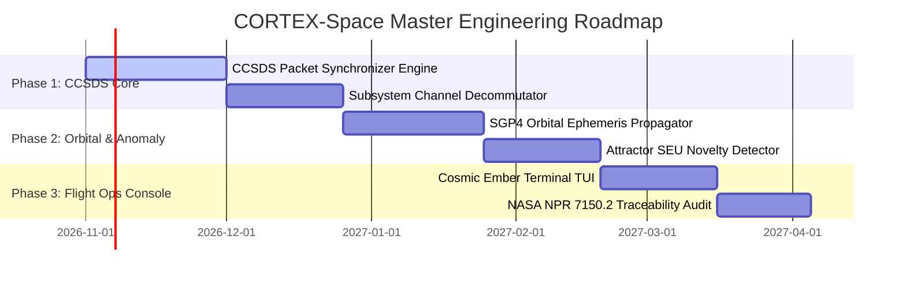

# CORTEX-Space: Master Product Requirements Document (PRD) & Software Requirements Specification (SRS)

**System Identifier:** `SYS-CORTEX-SPACE`  
**Document Revision:** `2.2.0-DETAILED`  
**Architectural Tier:** Orbital Satellite Telemetry Stream Parsing, SEU Anomaly Tracking & Spacecraft Simulation  
**Engineering Standards:** NASA NPR 7150.2 (Software Engineering Requirements), NASA SP-8000, CCSDS Standards  
**Design Identity:** Cosmic Ember & Burnished Gold (Void `#121014`, Nebula Plum `#33202E`, Cosmic Burgundy `#86455D`, Solar Ember `#E77C53`, Starlight Gold `#E9BD73`)  

---

# SECTION I: PRODUCT REQUIREMENTS DOCUMENT (PRD)

## 1. Executive Summary & Vision

### 1.1 Mission Statement
**CORTEX-Space** is a high-reliability ground-based orbital mission simulation and telemetry analysis platform. Engineered in alignment with NASA software engineering qualification methodologies (**NASA NPR 7150.2** and **NASA SP-8000**), CORTEX-Space processes raw Consultative Committee for Space Data Systems (CCSDS) packet streams, models 3D satellite orbital ground tracks, monitors critical spacecraft subsystems (Electrical Power System [EPS], Attitude Determination and Control System [ADCS], Thermal Control System [TCS]), and detects radiation-induced Single Event Upsets (SEU) using continuous attractor anomaly scoring.

### 1.2 Ground-Simulation & Traceability Principle
* **Simulation-Only Scope**: CORTEX-Space is an advanced telemetry analysis and simulation environment; it is **not** currently flight software deployed aboard operational satellite bus microcontrollers.
* **Requirements-to-Test Traceability**: In accordance with NASA NPR 7150.2 Class C software engineering standards, every software requirement maps bidirectionally to automated unit, integration, and fault-injection test suites.
* **Deterministic Telemetry Boundaries**: Telemetry decoding, frame synchronization, and CRC verification remain strictly deterministic and mathematically verifiable, separating neural anomaly detection from critical command validation.

---

## 2. Market Problem Formulation & Flaw Analysis

| Problem Dimension | Legacy Ground Station Software (COSMOS / OpenMCT) | Generic Time-Series Anomaly Detectors | CORTEX-Space Solution |
|---|---|---|---|
| **Anomaly Detection** | Relies on static yellow/red out-of-limits alarms; misses subtle multivariate correlations across subsystems. | Fails on orbital periodicity (day/night solar cycles cause false thermal alarms). | **Attractor Periodicity Modeling**: Continuous Hopfield basins model orbital phase-dependent baseline envelopes naturally. |
| **Telemetry Parsing** | Monolithic, heavy Java/C++ desktop applications requiring complex database backends. | Generic streaming parsers lack understanding of CCSDS frame sync or Reed-Solomon error correction. | **Headless CCSDS Engine**: Fast, vectorized Python/C++ frame synchronizer with automated bit-slip recovery. |
| **Radiation SEU Detection** | Requires manual telemetry post-mortems after bit-flips have already corrupted flight computers. | High false alarm rate due to random cosmic background noise. | **CORTEX-Shield Novelty Projection**: Accurately isolates latch-up transients from routine orbital flux. |
| **Mission Visualization** | Clunky 2D strip-charts with neon blue military aesthetics that obscure thermal warnings. | Generic web dashboards lacking orbital ephemeris or ground station line-of-sight cones. | **Cosmic Ember & Burnished Gold**: Deep space palette highlighting thermal alarms in Solar Ember and tracks in Cosmic Burgundy. |

---

## 3. User Personas & Mission Scenarios

### 3.1 Personas
* **Flight Operations Engineer (Ground Controller)**: Monitors live downlink passes during 10-minute ground station visibility windows; requires instant status assessment.
* **Spacecraft Subsystem Specialist (Thermal / Power)**: Investigates battery depth-of-discharge curves and solar array degradation over 5,000+ orbital orbits.
* **Orbital Mission Analyst**: Simulates constellation coverage, ground station handovers (Goldstone, Madrid, Canberra), and drag decay.

### 3.2 Telemetry Ingestion & Anomaly Workflow

```
┌────────────────────────────────────────────────────────────────────────┐
│               CORTEX-Space Telemetry Processing Flow                   │
│                                                                        │
│   [Raw RF Downlink Stream: S-Band / X-Band Bitstream]                  │
│                 │                                                      │
│                 ▼                                                      │
│   [CCSDS Frame Synchronizer: Sync Marker 0x1ACFFC1D]                   │
│                 │                                                      │
│                 ▼                                                      │
│   [Reed-Solomon (255, 223) Error Correction & CRC-16 Check]            │
│                 │                                                      │
│                 ▼                                                      │
│   [Telemetry Packet Decommutator: Extract Subsystem Channels]          │
│   EPS: Bus Voltage / Battery Temp · ADCS: Gyro Rates · TCS: Heaters    │
│                 │                                                      │
│                 ▼                                                      │
│   [CORTEX Continuous Attractor Telemetry Evaluator]                    │
│   Projects live vector onto expected orbital phase attractor basin     │
│                 │                                                      │
│        ┌────────┴──────────────────────────┐                           │
│        ▼                                   ▼                           │
│   [Nominal Basin Convergence]       [Radiation SEU / Thermal Anomaly]  │
│   Energy E(x) <= E_nominal          Energy Divergence E(x) > E_thresh  │
│   Status: VERIFIED                  Status: ANOMALY_DETECTED           │
│        │                                   │                           │
│        └────────┬──────────────────────────┘                           │
│                 ▼                                                      │
│   [Mission Control TUI: 3D Orbital Ground Track & Telemetry Matrix]    │
└────────────────────────────────────────────────────────────────────────┘
```

---

## 4. Master Implementation Roadmap



---

# SECTION II: SOFTWARE REQUIREMENTS SPECIFICATION (SRS)

## 1. Technical Stack & Dependencies

* **Core Runtime**: Python 3.12 / C++20 CCSDS Bit-Level Extensions.
* **Orbital Mechanics**: `sgp4` (Simplified General Perturbations 4 Satellite Propagator), `skyfield` (Astrometry and ephemeris).
* **Protocol Standards**: CCSDS 131.0-B-3 (TM Synchronization and Channel Coding), CCSDS 132.0-B-2 (TM Space Data Link Protocol).
* **Telemetry Serialization**: Space Packet Protocol (CCSDS 133.0-B-1) / binary bit-struct decoding.
* **NASA Qualification Benchmark**: NASA-STD-8739.8 (Software Assurance), NPR 7150.2D (Class C Software Engineering).

---

## 2. Mathematical & Telemetry Formulations

### 2.1 CCSDS Frame Synchronization & Reed-Solomon Coding
Telemetry frames begin with the standard 32-bit Attached Sync Marker (ASM):
$$\text{ASM} = \mathtt{0x1ACFFC1D} = [0001\ 1010\ 1100\ 1111\ 1111\ 1100\ 0001\ 1101]_2$$
Frames are protected by Reed-Solomon $RS(255, 223)$ code over Galois Field $GF(2^8)$, correcting up to $t = 16$ byte errors per 255-byte codeword block:
$$2t = n - k = 255 - 223 = 32\text{ parity bytes}$$

### 2.2 SGP4 Orbital State Propagation
Satellite position $\mathbf{r}(t) \in \mathbb{R}^3$ and velocity $\mathbf{v}(t) \in \mathbb{R}^3$ in Earth-Centered Inertial (ECI J2000) coordinates are propagated from Two-Line Element sets (TLE) via SGP4:
$$\mathbf{r}_{\text{ECI}}(t), \mathbf{v}_{\text{ECI}}(t) = \text{SGP4}\left(\text{TLE}, t - t_0\right)$$
Sub-satellite geographic coordinates (Latitude $\phi$, Longitude $\lambda$, Altitude $h$) are derived via Greenwich Mean Sidereal Time (GMST) rotation $\boldsymbol{\Theta}(t)$:
$$\mathbf{r}_{\text{ECEF}}(t) = \mathbf{R}_z(\text{GMST}(t)) \mathbf{r}_{\text{ECI}}(t)$$

### 2.3 Attractor Radiation SEU Anomaly Scoring
The spacecraft telemetry state vector $\mathbf{x}_{\text{telem}} = [V_{\text{bus}}, I_{\text{array}}, T_{\text{bat}}, \omega_x, \omega_y, \omega_z]$ is mapped to continuous attractor energy:
$$E(\mathbf{x}) = -\frac{1}{\beta} \ln \sum_{k=1}^K \exp\left(\beta \mathbf{x}_{\text{telem}}^T \mathbf{p}_k(\theta_{\text{orbit}})\right)$$
Where $\mathbf{p}_k(\theta_{\text{orbit}})$ are nominal prototype states parameterized by true anomaly $\theta_{\text{orbit}}$ (accounting for day/night eclipse transitions).
An abrupt divergence ($\Delta E > E_{\text{critical}}$ occurring within $\Delta t \le 1.0\text{ s}$) with sudden current spike signals an SEU latchup event.

---

## 3. Detailed Functional Requirements (FRs)

### FR-SPC-01: CCSDS Frame Synchronization
* **Input**: Unsynchronized serial bitstream buffer.
* **Processing**:
  1. Correlate bitstream with ASM mask `0x1ACFFC1D` (allowing up to 2 bit-errors).
  2. Frame lock state machine transitions: `SEARCH` $\to$ `CHECK` $\to$ `LOCK`.
  3. De-interleave and execute Reed-Solomon error correction.
  4. Verify 16-bit Cyclic Redundancy Check (CRC-CCITT).
* **Output**: Validated CCSDS Transfer Frame packet.

### FR-SPC-02: Orbital Ground Track Propagation
* **Input**: NORAD Two-Line Element (TLE) set, simulation epoch timestamp.
* **Processing**:
  1. Evaluate SGP4 perturbation equations.
  2. Compute sub-satellite latitude/longitude points for next 3 orbits ($270\text{ minutes}$).
  3. Calculate visibility cones for ground stations (Goldstone, Madrid, Canberra) at minimum elevation angle $\ge 10.0^\circ$.
* **Output**: `OrbitalGroundTrack` object containing trajectory points and pass schedules.

### FR-SPC-03: Radiation SEU Anomaly Detection
* **Input**: Decommutated telemetry frame.
* **Processing**:
  1. Extract orbital true anomaly $\theta_{\text{orbit}}$; select appropriate nominal attractor prototypes.
  2. Compute Lyapunov energy $E(\mathbf{x}_{\text{telem}})$.
  3. If $E > E_{\text{critical}}$, isolate anomalous telemetry channel.
  4. Flag Single Event Upset (SEU) with timestamp, subsystem ID, and severity level.
* **Output**: `AnomalyAlert` packet logged to flight telemetry recorder.

---

## 4. Non-Functional Software Requirements (NFSRs)

### NFSR-SPC-01: NASA NPR 7150.2 Class C Compliance
* $100\%$ bidirectional traceability from all functional requirements to automated unit tests.
* Zero compiler warnings under strict static analysis flags.

### NFSR-SPC-02: Telemetry Throughput & Jitter Budgets
* Processing throughput: $\ge 50,000\text{ CCSDS frames/second}$ on standard server core.
* Ground track propagation latency: $\le 5.0\text{ ms}$ for 24-hour orbital trajectory.

### NFSR-SPC-03: Visual Identity & Design System Integration
* Complies with **Cosmic Ember & Burnished Gold**:
  - Void (`#121014`): Deep space mission canvas (70%).
  - Nebula Plum (`#33202E`): Orbital ribbon trays and telemetry panels (20%).
  - Cosmic Burgundy (`#86455D`): **Signature Accent** — Orbital trajectory ground tracks (10%).
  - Solar Ember (`#E77C53`): SEU radiation alarms, thermal warnings, and solar array status.
  - Starlight Gold (`#E9BD73`): Ground station line-of-sight cones and coordinate ephemeris.
